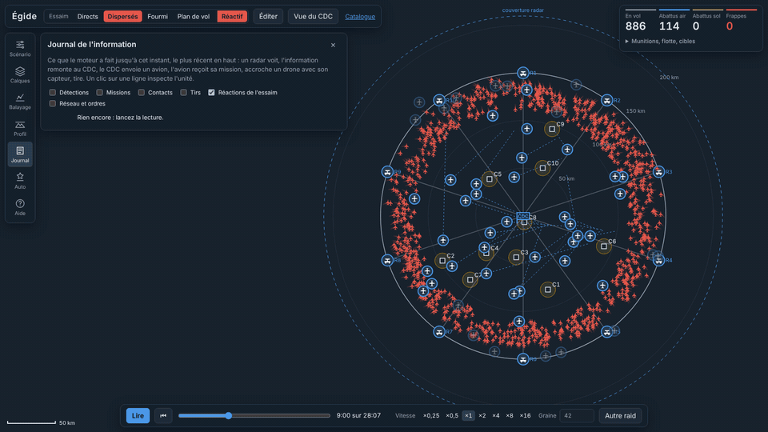
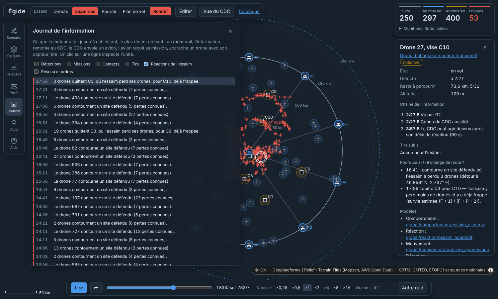
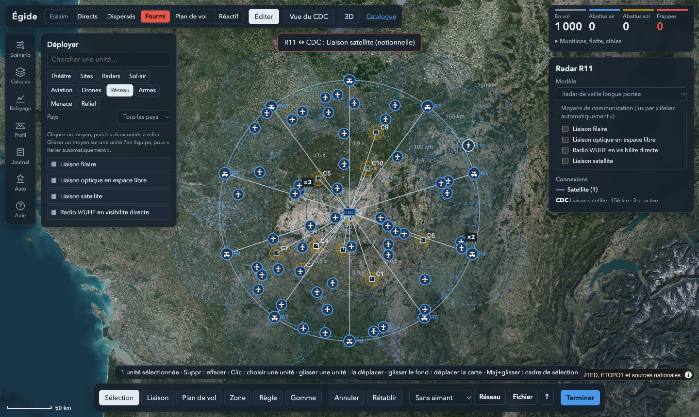
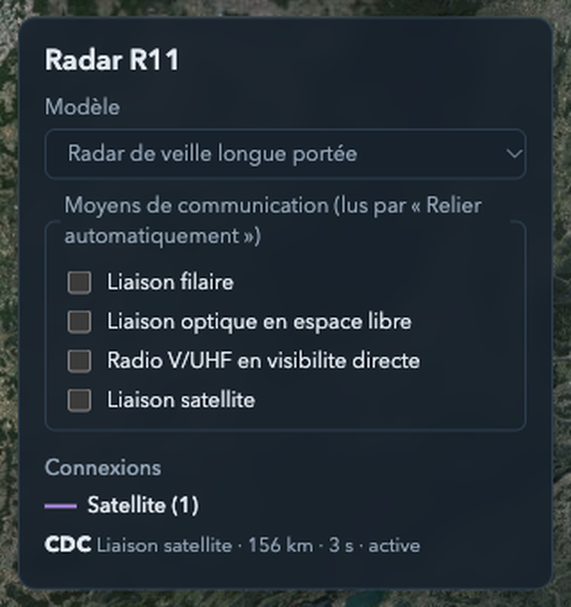

# Égide

Simulation de défense du territoire face à un essaim de drones rapides, jouable comme un jeu de stratégie vu de
dessus et assez rigoureuse pour en prouver les résultats. Vous déployez radars, centres de commandement et de contrôle
(C2), batteries sol-air, avions et drones défensifs sur la vraie Terre et son relief ; vous les reliez par radio,
satellite, fil ou optique ; l'essaim attaque selon la tactique choisie ou le plan de vol que vous dessinez, et peut
**réagir** : il apprend de ses pertes, se reporte sur les cibles qui cèdent, contourne vos sites et esquive vos tirs.
Égide compte les frappes, raconte qui a vu quoi, et dit pourquoi chaque unité a agi.


> Scénario notionnel : ordres de grandeur publics, aucune performance réelle de système identifié. Le dépôt public
> ne contient que des modèles notionnels ; les modèles de systèmes réels se rangent dans un catalogue privé
> (`prive/`, ignoré par git) que l'outil charge de la même façon.

## Sommaire

1. [Installer et lancer](#1--installer-et-lancer)
2. [Prise en main en cinq minutes](#2--prise-en-main-en-cinq-minutes)
3. [L'écran](#3--lécran)
4. [Jouer un raid](#4--jouer-un-raid)
5. [Déployer ses forces](#5--déployer-ses-forces)
6. [Le réseau d'information](#6--le-réseau-dinformation)
7. [Drones défensifs](#7--drones-défensifs)
8. [Relief](#8--relief)
9. [Configuration automatique](#9--configuration-automatique)
10. [Comprendre : inspecteur et catalogue](#10--comprendre--inspecteur-et-catalogue)
11. [Analyser et prouver](#11--analyser-et-prouver)
12. [Étendre : unités, algorithmes, cartes](#12--étendre--unités-algorithmes-cartes)
13. [Questions fréquentes](#13--questions-fréquentes)
14. [Ce que montre le scénario de référence](#14--ce-que-montre-le-scénario-de-référence)

## 1 · Installer et lancer

Il faut Python 3 (présent sur macOS et la plupart des Linux) et un navigateur récent. Rien d'autre à installer :
JavaScript sans compilation, bibliothèques embarquées dans `vendor/`.

| Système | Lancer |
|---|---|
| macOS | double-clic sur `lancer.command` |
| Windows | double-clic sur `lancer.bat` |
| Linux, ou tout terminal | `python3 -m http.server 8766 --bind 127.0.0.1`, puis ouvrir http://127.0.0.1:8766 |

La page s'ouvre sur http://127.0.0.1:8766 avec le scénario de référence : 1 000 drones à 800 km/h contre 10 sites,
200 postes sol, 50 avions et une couronne de radars. Le fond de carte vient d'Internet ; sans réseau, la simulation
tourne quand même (panneau Calques, « Scope seul »).

## 2 · Prise en main en cinq minutes

1. **Lire un raid** : « Lire » (ou Espace). Les drones (demi-losanges rouges) entrent par un couloir, les avions
   (dômes bleus) convergent, le bilan en haut à droite compte drones en vol, abattus en l'air, abattus au sol et
   frappes. La frise et les vitesses ×0,25 à ×16 sont en bas ; ← et → sautent de 30 s.
2. **Changer de tactique** : en haut, « Directs », « Dispersés », « Fourmi » ou « Plan de vol ». Le raid se recalcule
   aussitôt ; « Autre raid » tire une autre graine. Cochez « Réactif » (R) pour que l'essaim manœuvre contre vous.
3. **Demander pourquoi** : cliquez un avion, un drone, un radar ou un site. L'inspecteur, à droite, dit pourquoi l'avion
   a été envoyé là, quels tirs le drone a subis, ce que le radar voit.
4. **Déployer** : « Éditer » (E). La palette du catalogue s'ouvre à gauche ; cliquez « Radar de veille longue
   portée », puis un point de la carte : le radar y est, avec sa couverture. Échap pour finir, Ctrl+Z pour annuler.
5. **Comparer** : « Terminer », puis « Lire » ; le bilan a changé. Le panneau Balayage dira si l'écart tient sur
   plusieurs raids.

## 3 · L'écran

La carte occupe tout l'écran ; le reste flotte par-dessus et se replie.

- **En haut** : la tactique de l'essaim, « Éditer », la « Vue du CDC » (ce que sait le centre), le lien Catalogue.
- **À gauche** : un rail de sept panneaux, un à la fois — Scénario, Calques, Balayage, Profil, Journal,
  Auto-configuration, Aide. En édition, la palette « Déployer » prend leur place.
- **À droite** : le bilan en quatre chiffres et ses détails repliés (munitions, flotte, frappes par site), puis
  l'inspecteur au clic, ou en édition la fiche de l'unité sélectionnée.
- **En bas** : la lecture (frise, vitesses, graine) et, en édition, la barre d'outils.

Symbologie inspirée d'APP-6 :

| Symbole | Entité |
|---|---|
| Dôme bleu plein / creux | Avion à roquettes IR / laser |
| Losange, triangle, cercle bleus | Drone défensif armé, intercepteur à usage unique, brouilleur |
| Cadre bleu R1, R2… | Radar, avec sa couverture en tirets |
| Cadre bleu CDC | Centre de commandement et de contrôle |
| Carré C1, C2… | Site sensible à défendre ; cercle ocre : la bulle de ses postes sol, qui pâlit à mesure qu'ils s'épuisent |
| Triangle ocre B1, B2… | Batterie sol-air placée une à une, avec sa propre bulle |
| Demi-losange rouge / gris | Drone ennemi détecté / pas encore détecté |
| Traits entre unités | Liaisons : plein pour le fil, tirets pour la radio, pointillés pour le satellite ; barré rouge si coupée |

### Icônes de jeu et pays

Par défaut, chaque unité est dessinée en **icône de jeu** : une silhouette vue de dessus (radar sur pylône ou mobile,
batterie, canon, turbopropulseur, chasseur, hélicoptère, drone armé, intercepteur, brouilleur…) sur une pastille à la
couleur de son pays, cerclée de bleu pour les unités amies et d'ocre pour les batteries. L'essaim apparaît en petites
silhouettes rouges, grises tant qu'il n'est pas détecté. Le calque « Icônes de jeu » ramène les symboles APP-6.

Le catalogue compte 35 unités fictives inspirées de classes de 14 pays : radars, batteries à missiles ou à canons,
avions et hélicoptères, drones défensifs, drones d'attaque. Leurs noms sont des noms de plantes (Ajonc 300, Genêt 35,
Orpin H, Chardon D…) et leurs valeurs celles de leur classe, arrondies : aucune ne correspond à un système réel.


Le panneau **Calques** choisit le fond de carte (photographies IGN par défaut, sombre, OpenStreetMap ou plan, relief ombré ou
3D, bâtiments 3D, globe) et affiche ou masque chaque famille d'entités. Ce qui est masqué ne se survole, ne s'inspecte
ni ne s'édite.


### Raccourcis

| Touche | Action | Touche | Action |
|---|---|---|---|
| Espace | Lire / pause | ← → | Reculer / avancer de 30 s |
| 1 à 7 | Ouvrir un panneau | Échap | Fermer le panneau ou l'inspecteur |
| E | Éditer | V | Vue du CDC |
| R | Essaim réactif ou non (hors édition) | | |
| S, C, R, K, L, P, Z | Outils Sélection, Cible, Radar, CDC, Liaison, Plan de vol, Zone (en édition) | Suppr | Effacer la sélection (en édition) ou la mettre hors service (en plein raid) |
| X | Gomme : effacer l'unité cliquée | Maj+clic | Pendant un dépôt : effacer l'unité visée (curseur rouge) |
| Ctrl+1 à 9 | Mémoriser la sélection comme groupe | 1 à 9 | Rappeler le groupe (en édition) |
| Ctrl+Z | Annuler le dernier geste | Clic droit | Envoyer la sélection au point visé |
| Molette | Zoom | Alt+glisser, bouton du milieu | Déplacer la vue |

## 4 · Jouer un raid

### Trois tactiques adverses, plus la vôtre, et un essaim qui réagit

<table>
<tr>
<td width="50%"></td>
<td width="50%"></td>
</tr>
<tr>
<td><b>Fourmi</b>, vue zoomée : tout l'essaim entre par un même couloir, éclate, puis se répartit sur ses cibles pendant que les avions convergent.</td>
<td><b>Groupes directs</b> : chaque groupe arrive d'un cap tiré au hasard, en vague serrée, droit sur sa cible.</td>
</tr>
<tr>
<td colspan="2" align="center"></td>
</tr>
<tr>
<td colspan="2"><b>Dispersés</b> : chaque drone vient seul, de n'importe quel cap, départs étalés. La plus facile à défendre : les avions trouvent des cibles partout. La quatrième tactique, <b>Plan de vol</b>, suit l'itinéraire que vous dessinez (outil P de l'éditeur) ; le panneau Profil trace son altitude au-dessus du relief.</td>
</tr>
<tr>
<td colspan="2" align="center"></td>
</tr>
<tr>
<td colspan="2"><b>Réactif</b>, ici sur les dispersés, de 9:00 à 21:00 : les drones contournent les sites où l'essaim a déjà perdu des siens, puis quittent C3, qui tue, pour C9 et C10, déjà frappées. Le journal, filtré sur « Réactions de l'essaim », raconte chaque décision. La case Réactif se combine à n'importe quelle tactique (voir ci-dessous).</td>
</tr>
</table>

### Un essaim qui réagit

Cochez **Réactif** à côté des tactiques : l'essaim cesse de voler droit et cherche à maximiser ses frappes. Il ne voit
pas votre défense ; il apprend par ses pertes, que son réseau maillé fait connaître à tous les drones en 2 s.

- **Il se reporte sur la brèche.** Un drone dont la cible tue ses semblables la quitte pour une cible déjà frappée, où
  l'essaim perd moins de drones, si le détour reste court. Engagé à moins de 10 km de sa cible, il n'en change plus.
- **Il contourne vos sites défendus.** Quand un site où l'essaim a perdu des drones est sur sa route, il passe à la
  tangente, à bonne distance, sans allonger sa route de plus de 30 %.
- **Il esquive vos tirs air.** Visé par une roquette, il manœuvre jusqu'à l'impact : le Pk du tir baisse de 30 %, au
  prix d'une avance ralentie.

Le tableau de bord compte réaffectations, détours et tirs esquivés ; le journal (famille « Réactions de l'essaim »)
regroupe les décisions ; cliquez un drone : l'inspecteur dit **pourquoi il a changé de route**.



Même raid, même graine, avec et sans réaction (duel apparié sur 10 graines du scénario de référence, IC 95 %) :

| Tactique | Frappes, essaim inerte | Avec réaction |
|---|---|---|
| Fourmi | 362 | **+147 ± 80** (+41 %) |
| Directs | 486 | **+90 ± 68** (+18 %) |
| Dispersés | 182 | **+115 ± 14** (+63 %) |

Le dispersé, la tactique la plus facile à défendre, gagne le plus : ses départs étalés laissent aux derniers drones le
temps d'apprendre des premiers. Les réglages (délai du réseau, rayon d'un site défendu, seuils, esquive) sont des
clés `rouge.reaction_*` du scénario ; modèle et hypothèses : [docs/MODELE.md § 22](docs/MODELE.md).

### Régler le scénario

Le panneau **Scénario** règle tout par curseurs : nombre et vitesse des drones, avions par type, postes sol et
munitions, drones défensifs, délai de réaction du CDC, réseau, terrain. Chaque réglage porte sa phrase d'aide. On y
trouve aussi la **bibliothèque** (scénarios du dépôt et ceux rangés dans ce navigateur), les réglages enregistrés,
l'export et l'import d'un scénario, et « Revenir à la référence ».

Même raid fourmi, même graine, en fin de raid :

<table>
<tr>
<td width="50%"></td>
<td width="50%"></td>
</tr>
<tr><td>Avec 50 avions : <b>469 frappes</b>.</td><td>Sans avions : <b>713 frappes</b>.</td></tr>
</table>

### Donner des ordres en plein raid

Mettez en pause, puis « Éditer » : l'éditeur passe en **mode ordres**. Sélectionnez des avions (clic, Maj+clic,
rectangle) puis clic droit pour les envoyer depuis le CDC ; sélectionnez un radar, un CDC ou une liaison puis Suppr
pour le mettre hors service à cet instant. Tout est enregistré dans le scénario avec son instant, et le raid se
rejoue à l'identique.


## 5 · Déployer ses forces

« Éditer » au début du raid ouvre l'**éditeur de déploiement** : la palette du catalogue à gauche, la fiche de
l'unité sélectionnée à droite, la barre d'outils en bas.


### Poser des unités

La palette range le catalogue par famille, chaque unité avec son icône et son pays ; le filtre « Pays » n'affiche que
les unités d'un pays (et les génériques). Pour poser une unité :

- **cliquez-la dans la palette, puis cliquez la carte**, autant de fois qu'il faut ; Échap pour finir ;
- **ou glissez-la** de la palette sur la carte.

| Famille | Ce que fait un dépôt |
|---|---|
| Infrastructures | Un **site sensible** à défendre (il reçoit sa part des postes sol communs) ou un **centre C2** de plus |
| Capteurs | Un radar **de ce modèle** : chaque radar garde sa hauteur d'antenne et sa portée. Le premier dépôt fait passer la couronne « frontière » en radars placés un à un |
| Défense sol | Une **batterie** de ce modèle, avec sa propre bulle et ses munitions (40 par défaut) |
| Aviation, Drones défensifs | Un vecteur en orbite au point déposé, ou plusieurs (« Vecteurs par dépôt ») en petit cercle autour. Chaque modèle forme un groupe, qui grossit à chaque dépôt |
| Communications | À déposer **sur une unité déjà placée** : elle est équipée de ce moyen (voir plus bas) |
| Armements | À déposer **sur un avion ou un drone défensif** : tout son groupe change d'emport |
| Menace, Terrain | Le modèle de drone de l'essaim, ou le relief du théâtre, où qu'on le dépose |

La barre d'outils garde les outils d'avant pour les gestes rapides : **Sélection** (S) pour glisser, sélectionner au
rectangle ou à Maj+clic, envoyer au clic droit en gardant la formation ; **Cible** (C), **Radar** (R) et **CDC** (K) pour
poser l'unité par défaut ; **Plan de vol** (P) ; **Zone** (Z), un clic par sommet, double-clic ou Entrée pour fermer,
qui compte les incursions. Suppr efface la sélection, Ctrl+Z annule, Ctrl+1 à 9 mémorise un groupe et 1 à 9 le rappelle.
La vue ne bouge pas pendant l'édition, même quand un radar déposé loin agrandit le théâtre.

**Effacer** : pendant un dépôt, enfoncez Maj : le curseur passe de « + unité » en vert à « − Effacer » en rouge et
l'unité visée est barrée ; Maj+clic l'efface. L'outil **Gomme** (X) fait de même à chaque clic. **Tout effacer** vide la
carte — radars, batteries, postes, vecteurs, autres C2, liaisons, moyens, zones, plan de vol, ordres — pour repartir
de zéro ; restent le CDC principal et un site à défendre, et Ctrl+Z ramène tout.



### Équiper et relier

Chaque unité peut déclarer ses **moyens de communication** : filaire, radio V/UHF, satellite, optique (catalogue
`unites/liaisons/`, chacun avec sa latence, sa portée et son besoin de vue directe). Déposez un moyen sur l'unité, ou
cochez-le dans sa fiche. Une unité qui n'en déclare aucun accepte tout moyen.

- **Liaison** (L) : un clic sur une unité, un clic sur l'autre. La liaison prend le moyen choisi dans la liste s'il
  est commun aux deux, sinon le plus rapide de leurs moyens communs ; sans moyen commun, elle est refusée et le
  message dit pourquoi.
- **Relier automatiquement** : chaque unité équipée est reliée à chaque C2 avec qui elle partage un moyen à portée,
  le plus rapide ; les C2 sont reliés entre eux. La portée tient compte de l'horizon : une radio au sol, mâts de 15 m,
  ne porte qu'à une trentaine de kilomètres, alors qu'un avion à 1 000 m s'entend à 140 km. Les unités qui restent
  hors réseau sont nommées ; le relief est vérifié pendant la simulation.
- **Réseau complet** revient à « tout le monde parle avec tout le monde, sans délai ».

### Régler une unité : la fiche

Sélectionnez une unité (ou plusieurs, jusqu'à quatre fiches) : sa fiche s'ouvre à droite.

| Unité | Ce que la fiche règle |
|---|---|
| Radar | Son modèle (ou celui commun à tous), ses moyens de communication |
| Batterie | Son modèle, ses munitions, son algorithme de tir sol, ses moyens |
| Avion ou drone défensif | Pour tout son groupe : modèle, nombre, altitude, armement, algorithmes de mouvement et de tir, moyens |
| CDC principal | Algorithmes d'allocation et de pistage, délai de réaction, moyens |
| Autre C2 | Son nom, son propre algorithme d'allocation (ou celui du principal), ses moyens |
| Site sensible | Les moyens de ses postes sol |
| Liaison | Son moyen |

Pour chaque algorithme, « hérité » garde celui du modèle ; un choix le remplace pour cette unité ou ce groupe
seulement. Les algorithmes proposés sont ceux du dossier `algos/` (et de votre catalogue privé).



### Enregistrer et recharger

En haut de la palette, donnez un nom au déploiement :

- **Enregistrer** le range dans la bibliothèque de ce navigateur ; il se recharge depuis la liste Bibliothèque du
  panneau Scénario ;
- **Exporter** télécharge le scénario complet en JSON, à archiver, versionner ou partager ;
- **Importer** recharge un fichier exporté (aussi depuis le panneau Scénario).

Chaque geste et chaque réglage de fiche est une modification du scénario, comme un curseur : l'annulation, l'export,
la bibliothèque et la reproductibilité par la graine valent pour tout ce que vous déployez.

## 6 · Le réseau d'information

Par défaut, tout le monde parle avec tout le monde, sans délai. Dès la première liaison tracée, le réseau devient
explicite, et l'information prend du temps et peut se perdre :

- un C2 n'apprend un drone qu'après la latence du chemin depuis le radar qui le voit ; un radar non relié voit pour rien ;
- ses consignes, comme vos ordres, n'arrivent à l'avion qu'après la latence de sa liaison ; un avion hors de portée
  radio n'est plus affecté (croix rouge) ;
- les pannes se datent ; le CDC peut devenir une cible de l'essaim (panneau Scénario), détruit à la première frappe.


### Voir l'information circuler

Impulsion bleue d'un radar vers le C2 avec le nombre de drones signalés (rouge et arrêtée si le radar n'est pas relié),
impulsion blanche du C2 vers l'avion qu'il envoie, cercle blanc à la réception de la mission, tirets jaunes quand un
avion accroche un drone avec son propre capteur.


Le panneau **Journal** raconte la même histoire en phrases, filtrable ; l'inspecteur d'un drone en donne la chaîne
complète : vu par tel radar, connu du C2, délai de réaction, accroché, tiré.


### Plusieurs centres

Chaque C2 reçoit ses radars, en fait des pistes, envoie les avions qu'il joint le plus vite et désigne les drones aux
postes sol qu'il joint. Il échange ses pistes avec les autres par le réseau et reprend les avions d'un centre qui
tombe. Un poste sol désigné tire dès que le drone entre dans sa bulle ; seul, il doit d'abord l'acquérir (10 s,
notionnel).


| Scénario de référence en liaisons, 8 raids | Détruits au sol | Frappes |
|---|---|---|
| Postes sol reliés au CDC | 312 | 432 ± 52 |
| Postes sol seuls | 231 | 515 ± 42 |

**Vue du CDC** (V) : l'écran ne montre plus que ce que sait le centre — les drones qu'il connaît, regroupés en pistes
par son algorithme de pistage. La vérité terrain revient au même bouton.


## 7 · Drones défensifs

Trois familles notionnelles, soumises aux mêmes règles que les avions (mission du centre, mise à poste, accroche,
engagement) : **drones armés** (deux charges de courte portée), **intercepteurs à usage unique** (ils percutent leur
cible et se perdent), **brouilleurs** (neutralisation à taux constant dans un rayon, sans modèle de signal). Posez-les
depuis la palette, ou réglez leur nombre dans le panneau Scénario.


| Ajoutés aux 50 avions, tactique fourmi, 6 raids | Frappes |
|---|---|
| Référence | 404 ± 51 |
| + 100 drones armés | 390 ± 52 |
| + 200 intercepteurs | 364 ± 51 |
| + 30 brouilleurs | 134 ± 98 (paramètre de brouillage notionnel, à calibrer) |

## 8 · Relief

Un terrain du catalogue, choisi dans le panneau Scénario ou déposé depuis la palette, donne au moteur le relief du
théâtre : chaque radar a son masque d'horizon, un drone qui vole bas derrière une crête n'est pas vu, et les liaisons
radio et optiques exigent la vue directe. L'écran trace la couverture réelle de chaque radar.


Le dépôt livre un relief synthétique de démonstration. Pour le vrai relief d'un théâtre, depuis un poste qui a le réseau :

```sh
node outils/terrain.js --nom centre_france --lat 47 --lon 2.5 --rayon_km 320 --pas_km 1
node outils/indexer.js
```

Le terrain est ensuite un fichier : le moteur travaille hors ligne.

## 9 · Configuration automatique

Le panneau **Auto** propose un déploiement complet à partir de trois questions :

1. **Les menaces** à considérer : tactiques et nombre de drones ;
2. **Les moyens disponibles** : radars, C2, sites, postes, munitions, avions et drones défensifs par type ;
3. **La zone** : un pays (frontières Natural Earth) ou une zone dessinée avec l'outil Zone.

« Lancer » construit le scénario (zone protégée, sites et centres bien répartis, radars le long de la frontière,
avions et drones défensifs placés) et cherche en simulation la répartition qui minimise les frappes, toutes menaces
confondues. Une barre de progression donne l'avancement et le temps restant ; « Arrêter » interrompt. Le résultat est
comparé à une répartition uniforme avec son intervalle de confiance, puis s'applique, se range dans la bibliothèque
ou s'exporte — et se retouche ensuite à la main dans l'éditeur.

<table>
<tr>
<td width="50%"></td>
<td width="50%"></td>
</tr>
</table>

```sh
node outils/frontieres.js                                     # une fois : frontières Natural Earth (domaine public)
node src/autoconfig.js --pays FRA --menaces fourmi:1000,direct:1000 --radars 30 --cibles 12 --centres 3 \
  --postes 400 --munitions 2000 --avions 20,30,40,0,10 --tirages 3     # écrit scenarios/auto_france.json
```

## 10 · Comprendre : inspecteur et catalogue

Un clic sur une entité ouvre l'**inspecteur**, mis à jour en direct : pour un avion, pourquoi le centre l'a envoyé là
(piste retenue, score, délai, alternatives écartées) et par quelle liaison il le joint ; pour un drone, chaque tir
subi, sa probabilité de survie Π(1 − Pk) et la cause de sa perte ; pour un site, sa défense ; pour un radar, sa
portée, son masquage par le relief et sa latence jusqu'au C2 ; pour un C2, l'état de tout le réseau.


Le lien **Catalogue** ouvre l'explorateur : une fiche par unité (fidélité, lignée, sources, paramètres avec l'ancêtre
qui les fixe, algorithmes) et par algorithme (équations, hypothèses, domaine de validité, références, code, utilisateurs).

<table>
<tr>
<td width="50%"></td>
<td width="50%"></td>
</tr>
</table>

L'encadré **Catalogue privé** de cette page importe vos unités de `prive/` : **Public seul**, **Fusionner** (elles
s'ajoutent aux unités publiques) ou **Remplacer** (elles prennent la place des unités publiques de leurs dossiers ;
terrains, armements et classes de base restent). Le choix est retenu par le navigateur et vaut aussi pour la palette
de la simulation (voir [§ 12](#12--étendre--unités-algorithmes-cartes)).


## 11 · Analyser et prouver

Un raid est un tirage : seule une série de raids dit si un déploiement fait mieux qu'un autre.

### Balayage

Le panneau **Balayage** fait varier un réglage, rejoue le raid sur plusieurs graines par valeur et trace chaque
grandeur avec son intervalle de confiance, calculé en arrière-plan.


### En ligne de commande

Toute valeur d'un scénario a un chemin (`bleu.avions.1.nombre`, `rouge.surcharges.vitesse_kmh`…) qui se règle en option :

```sh
node src/campagne.js                                            # scénario de référence, 50 raids
node src/campagne.js --scenario scenarios/mon_deploiement.json  # un scénario exporté de l'interface
node src/campagne.js --tirages 200 --rouge.tactique direct      # toute valeur se règle par son chemin
node src/campagne.js --balayer bleu.avions.1.nombre=0,10,30,60  # une campagne par valeur
uv run --with matplotlib python -m analyse.abaques              # abaques analytiques et récapitulatif
```

<table>
<tr>
<td width="50%"></td>
<td width="50%"></td>
</tr>
<tr>
<td>Vitesse minimale de mise à poste pour garantir k avions sur une route quelconque.</td>
<td>Postes sol nécessaires selon la concentration adverse, sans avions puis avec 20, 50 et 100 avions.</td>
</tr>
</table>

### Outils de preuve

Chaque résultat porte son **empreinte** (SHA-256 du scénario, des unités, des algorithmes en jeu et du code du
moteur) et ses écarts au scénario de référence : deux résultats de même empreinte et de mêmes graines sont identiques
au bit près.

```sh
node src/preuve.js dossier                                   # dossier Markdown : résultats, convergence, modèles, limites
node src/preuve.js convergence --pas 2,1,0.5,0.25 --tirages 10
node src/preuve.js duel --variante rouge.tactique=direct     # A contre B, mêmes graines, écart et verdict
node src/preuve.js morris --facteur bleu.avions.1.nombre=0:60 --facteur bleu.sol.nombre=0:200
node src/preuve.js empreinte
```

- **Convergence** : la campagne rejouée à plusieurs pas de temps, chaque pas comparé au plus fin tirage par tirage.
- **Duel A/B** : deux variantes sur les mêmes graines ; différence appariée, intervalle de confiance, gain des
  nombres aléatoires communs mesuré.
- **Morris** : classement des réglages par influence (μ*, μ, σ) et seuil de bruit ; il a révélé, par exemple, que
  l'étalement des départs n'a aucun effet hors tactique dispersée.

## 12 · Étendre : unités, algorithmes, cartes

Tout ce que la palette propose vient de fichiers ; en ajouter un suffit pour qu'il apparaisse.

```
unites/<famille>/<classe>/<unite>.json    une unité par fichier, héritage par herite_de, chaque clé documentée
icones/<silhouette>.svg                   icônes de jeu des unités
unites/liaisons/<moyen>.json              moyens de communication : latence, portée, vue directe
unites/terrains/<terrain>.json            reliefs : grilles d'altitudes (node outils/terrain.js)
algos/global/<rôle>/<algo>.js             un algorithme par module : fiche « meta » + fonctions du rôle, sans import
cartes/fonds|relief|batiments/<source>.json   une source de carte par fichier, attribution obligatoire
prive/unites/…  prive/algos/…             votre catalogue privé (ignoré par git), identifiants préfixés « prive/ »
scenarios/                                scénarios JSON, chaque clé documentée
schemas/                                  schémas JSON des fichiers (générés par node outils/indexer.js)
```

- **Unités** : un fichier ne dit que ce qui change par rapport à son parent (`herite_de`) ; les valeurs s'écrivent
  dans les unités du métier (`vitesse_kmh`, `portee_km`, `acquisition_s`…) et sont converties en SI à la lecture.
- **Algorithmes** : chaque décision (comportement, réaction, mouvement, détection, pistage, allocation, tir, tir sol) est un
  module interchangeable, choisi par une unité, un groupe, un centre ou le scénario. Il exporte sa fiche `meta` et les
  fonctions de son rôle, n'importe rien et reçoit géodésie et hasard à graine : il est pur et reproductible.
  `algos/global/allocation/plus_proche.js` sert d'exemple commenté.
- **Pays et icônes** : `pays` (code ISO à trois lettres) classe l'unité et colore sa pastille ; `icone` choisit une
  silhouette de `icones/` (SVG blanc, 64 × 64, vu de dessus).
- **Catalogue privé** : `prive/` reçoit vos unités et algorithmes réels, hors du dépôt public. Une unité privée se
  range dans une famille du moteur (`prive/vecteurs/avions/…`, `prive/sites/postes/…`) et hérite de sa base publique,
  qui lui apporte ses algorithmes : elle se joue alors comme une unité publique.

Après tout ajout : `node outils/indexer.js`, puis `npm test` — la conformité vérifie d'elle-même tout fichier déposé.
L'indexeur écrit aussi `prive/unites/index.json` (hors git), que lit l'import du catalogue privé : choisissez
**Fusionner** ou **Remplacer** dans la page Catalogue, et vos unités apparaissent dans la palette, se déposent et se
battent comme les autres.


Pour mesurer l'effet d'un changement : `node src/preuve.js duel --variante bleu.conduite.allocation=global/allocation/plus_proche`.

**Depuis un outil externe** (modeleur d'unités, générateur d'algorithmes, export d'un autre simulateur) : le format
exact de chaque fichier est fixé dans [docs/FORMATS.md](docs/FORMATS.md), avec des schémas JSON par famille dans
`schemas/` (générés depuis le catalogue) et un validateur qui applique les règles de la conformité :

```sh
node outils/valider.js prive/unites/capteurs/radars/mon_radar.json prive/algos/allocation/mon_algo.js
node outils/valider.js --json …     # rapport machine, code de sortie 0 ou 1
```

**Le guide complet est dans [docs/CATALOGUE.md](docs/CATALOGUE.md)** : familles d'unités, héritage, suffixes,
surcharges, rôles et contrat des algorithmes, exemple pas à pas, catalogue privé, conformité, cartes, reliefs,
liaisons, clés du déploiement, et preuve d'un changement.

## 13 · Questions fréquentes

**La page reste blanche, ou affiche une erreur de module.** Elle doit être servie par `lancer.command`, `lancer.bat`
ou `python3 -m http.server` : un fichier ouvert directement (`file://`) ne charge pas les modules JavaScript.

**Le fond de carte est vide.** Il vient d'Internet. Hors ligne, cochez « Scope seul » dans le panneau Calques : la
simulation n'en dépend pas.

**« Scénario refusé : … ».** Le message nomme la clé fautive (unité inconnue, surcharge d'une clé que l'unité n'a pas,
liaison vers un nœud qui n'existe plus). Ctrl+Z annule le dernier geste ; « Revenir à la référence » repart de zéro.

**Mon déploiement a disparu.** Les déploiements enregistrés vivent dans la mémoire de ce navigateur : un autre
navigateur, une navigation privée ou un effacement des données ne les voit pas. Exportez ce qui compte.

**« À déposer sur une unité déjà placée ».** Un moyen de communication ou un armement se lâche sur une unité, pas
dans le vide ; et une unité ne reçoit pas deux fois le même moyen.

**Une liaison est refusée.** Les deux unités ne partagent aucun moyen : équipez-les d'un moyen commun, ou videz leurs
moyens pour qu'elles acceptent tout.

**Une unité reste « hors réseau » après « Relier automatiquement ».** Aucun C2 ne partage avec elle un moyen à portée :
une radio au sol ne porte qu'à l'horizon des mâts ; ajoutez le fil ou le satellite, ou rapprochez un C2.

**« Choisissez une zone » dans Auto.** Les frontières des pays se téléchargent une fois avec
`node outils/frontieres.js` ; sinon, dessinez une zone avec l'outil Zone de l'éditeur.

**L'essaim réactif ne change pas de cible en début de raid.** C'est voulu : il ne se reporte que sur une cible déjà
frappée, une brèche avérée. Tant qu'aucun drone n'est passé, il contourne vos sites mais garde ses cibles ; se reporter
à l'aveugle vers des cibles aussi défendues que les autres lui faisait perdre des frappes (MODELE § 22.2).

## 14 · Ce que montre le scénario de référence

1 000 drones à 800 km/h, 10 sites, 200 postes sol, 50 avions à 500 km/h ; 30 raids par tactique, moyenne et
intervalle de confiance à 95 % :

| Tactique de l'essaim | Frappes sans avions | Frappes avec 50 avions | Détruits par les avions |
|---|---|---|---|
| Groupes directs | 650 ± 21 | 395 ± 27 | 257 |
| Dispersés | 524 ± 8 | **187 ± 11** | 407 |
| Fourmi (couloir compact puis éclatement) | 668 ± 19 | 401 ± 25 | 272 |

- Les avions divisent les frappes par 1,6 à 2,8. La tactique fourmi est la plus efficace pour l'attaquant : le couloir
  compact sature chaque avion sur un passage, et l'éclatement tardif oblige la flotte à se partager.
- Face aux groupes compacts, la limite est la cadence de tir par passage, pas le stock de munitions.
- Avec 50 avions, garantir 5 avions sur une route quelconque demande ~350 km/h ; 8 avions, ~465 km/h ; 10, ~525 km/h.

Le dossier de preuve (`node src/preuve.js dossier`) redonne 403 ± 26 frappes en tactique fourmi, et montre que le
pas de temps de 0,5 s a convergé alors que celui de 1 s ne l'a pas.

## Rigueur

- Unités SI et géodésie WGS84 dans tout le calcul ; Vincenty vérifié sur les exemples de GeographicLib au millimètre.
- Hasard à graine : une graine rejoue un raid à l'identique, ordres et pannes compris.
- Chaque formule codée cite son paragraphe de [docs/MODELE.md](docs/MODELE.md), et un test vérifie que chaque renvoi existe.
- Formules fermées et résolution des scénarios en Python et en JavaScript, vérifiées l'une contre l'autre ; simulation
  confrontée aux formules.
- Chaque refonte prouvée : le moteur géodésique retrouve les statistiques de la v0.1, le passage aux algorithmes en
  fichiers redonne les bilans exacts, et le réseau complet sans relief ni déploiement manuel laisse ces bilans inchangés.
- Limites connues : drones sans contre-mesures ni évitement, radar parfait dans sa portée, pas encore de débit ni de
  brouillage sur les liaisons, drones défensifs et brouillage notionnels, auto-configuration par recherche locale,
  batterie placée rattachée au nœud réseau du site le plus proche (MODELE § 7, § 15 à § 21).

## Documentation

- [docs/MODELE.md](docs/MODELE.md) : toutes les équations et hypothèses.
- [docs/CATALOGUE.md](docs/CATALOGUE.md) : étendre Égide — unités, algorithmes, catalogue privé, preuve d'un changement.
- [docs/FORMATS.md](docs/FORMATS.md) : formats d'échange pour les outils externes (unités, liaisons, terrains, algorithmes, scénarios).
- [docs/PLAN_V2.md](docs/PLAN_V2.md) : feuille de route, jalons, idées et suggestions retenues.
- [docs/PLAN_3D.md](docs/PLAN_3D.md) : plan des prochains jalons — déployer en 2D stricte, observer en 3D, sortie vers un moteur de jeu.

## Tests

```sh
npm test                 # rapide (plus de 200 tests, dont la conformité de tout le catalogue)
npm run test:complet     # ajoute l'équivalence avec la v0.1 (~2 min)
pytest -q tests
ruff check analyse tests
```


