# Égide

**English** · [Français](README.fr.md)

Territorial air-defence simulation against a swarm of fast drones, playable like a top-down strategy game and rigorous
enough to prove its results. You deploy radars, command and control centres (C2), ground air-defence batteries,
aircraft and defensive drones on the real Earth and its terrain; you link them by radio, satellite, wire or optics; the
swarm attacks with the chosen tactic or along the flight plan you draw, and can **react**: it learns from its losses,
switches to the targets that give way, bypasses your sites and dodges your fire. Égide counts the hits, tells who saw
what, and explains why each unit acted.

Two ways to use it, on the same engine: the **browser** to analyse and prove, **Godot** to play the defence in real
time, like a strategy game, and to edit scenarios and terrain there.

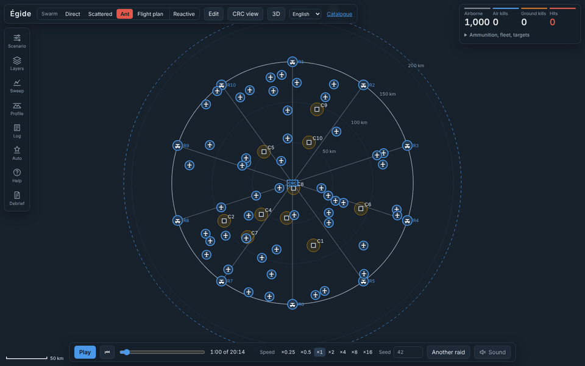

> Notional scenario: public orders of magnitude, no real performance of any identified system. The public repository
> only contains notional models; models of real systems go into a private catalogue (`prive/`, ignored by git) that
> the tool loads the same way.

The interface is available in **English** (default) and **French**: the language selector sits in the top bar, and
`?lang=fr` in the address forces French.

## Contents

1. [Install and run](#1--install-and-run)
2. [Getting started in five minutes](#2--getting-started-in-five-minutes)
3. [The screen](#3--the-screen)
4. [Playing a raid](#4--playing-a-raid)
5. [Playing in Godot](#5--playing-in-godot)
6. [Deploying your forces](#6--deploying-your-forces)
7. [The information network](#7--the-information-network)
8. [Defensive drones](#8--defensive-drones)
9. [Terrain](#9--terrain)
10. [Automatic configuration](#10--automatic-configuration)
11. [Understanding: inspector and catalogue](#11--understanding-inspector-and-catalogue)
12. [Analysing and proving](#12--analysing-and-proving)
13. [Extending: units, algorithms, maps](#13--extending-units-algorithms-maps)
14. [Frequently asked questions](#14--frequently-asked-questions)
15. [What the reference scenario shows](#15--what-the-reference-scenario-shows)

## 1 · Install and run

The browser interface needs Python 3 (present on macOS and most Linux systems) and a recent browser: JavaScript
without a build step, libraries bundled in `vendor/`. Command-line campaigns and the game also need Node, and the game
needs Godot 4: `installer.command` (macOS) or `installer.bat` (Windows) installs what is missing, then checks the
machine; it is safe to run again.

| System | Run |
|---|---|
| macOS | double-click `lancer.command` |
| Windows | double-click `lancer.bat` |
| Linux, or any terminal | `python3 -m http.server 8766 --bind 127.0.0.1`, then open http://127.0.0.1:8766 |
| Play in Godot | `jouer.command` (macOS), `jouer.bat` (Windows); see [§ 5](#5--playing-in-godot) |

The page opens at http://127.0.0.1:8766 with the reference scenario: 1,000 drones at 800 km/h against 10 sites,
200 ground posts, 50 aircraft and a ring of radars. The base map comes from the Internet; without a network the
simulation still runs (Layers panel, "Scope only").

## 2 · Getting started in five minutes

1. **Play a raid**: "Play" (or Space). The drones (red half-diamonds) come in through a corridor, the aircraft (blue
   domes) converge, and the summary at the top right counts drones airborne, air kills, ground kills and hits. The
   timeline and the ×0.25 to ×16 speeds are at the bottom; ← and → jump 30 s.
2. **Change tactic**: at the top, "Direct", "Scattered", "Ant" or "Flight plan". The raid is recomputed at once;
   "Another raid" draws another seed. Tick "Reactive" (R) to make the swarm manoeuvre against you.
3. **Ask why**: click an aircraft, a drone, a radar or a site. The inspector, on the right, tells why the aircraft was
   sent there, which shots the drone took, what the radar sees.
4. **Deploy**: "Edit" (E). The catalogue palette opens on the left; click "Long-range surveillance radar", then a point
   on the map: the radar is there, with its coverage. Esc to finish, Ctrl+Z to undo.
5. **Compare**: "Done", then "Play"; the summary has changed. The Sweep panel tells whether the difference holds over
   several raids.

## 3 · The screen

The map fills the screen; everything else floats above it and folds away.

- **Top**: the swarm tactic, "Edit", the "CRC view" (what the control centre knows), the language, the Catalogue link.
- **Left**: a rail of panels, one at a time — Scenario, Layers, Sweep, Profile, Log, Auto-configuration, Help,
  Debrief. While editing, the "Deploy" palette takes their place.
- **Right**: the four-figure summary and its folded details (ammunition, fleet, hits per site), then the inspector on
  click, or while editing the sheet of the selected unit.
- **Bottom**: playback (timeline, speeds, seed) and, while editing, the toolbar.

Symbology inspired by APP-6:

| Symbol | Entity |
|---|---|
| Solid / hollow blue dome | Aircraft with IR / laser rockets |
| Blue diamond, triangle, circle | Armed defensive drone, single-use interceptor, jammer |
| Blue frame R1, R2… | Radar, with its coverage dashed |
| Blue frame CDC | Control and reporting centre (CRC) |
| Square C1, C2… | Sensitive site to defend; ochre circle: the bubble of its ground posts, paling as they run out |
| Ochre triangle B1, B2… | Ground air-defence battery placed individually, with its own bubble |
| Red / grey half-diamond | Enemy drone detected / not yet detected |
| Lines between units | Links: solid for wire, dashes for radio, dots for satellite; crossed in red when cut |

### Game icons and countries

By default each unit is drawn as a **game icon**: a top-down silhouette (mast or mobile radar, battery, gun,
turboprop, fighter, helicopter, armed drone, interceptor, jammer…) on a disc in its country's colour, ringed in blue
for friendly units and in ochre for batteries. The swarm shows as small red silhouettes, grey while undetected.
Everything that moves is oriented along its track, in every view. The "Game icons" layer brings back the APP-6 symbols.

The catalogue holds 35 fictional units inspired by classes from 14 countries: radars, missile or gun batteries,
aircraft and helicopters, defensive drones, attack drones. Their names are plant names (Ajonc 300, Genêt 35, Orpin H,
Chardon D…) and their values those of their class, rounded: none of them matches a real system.

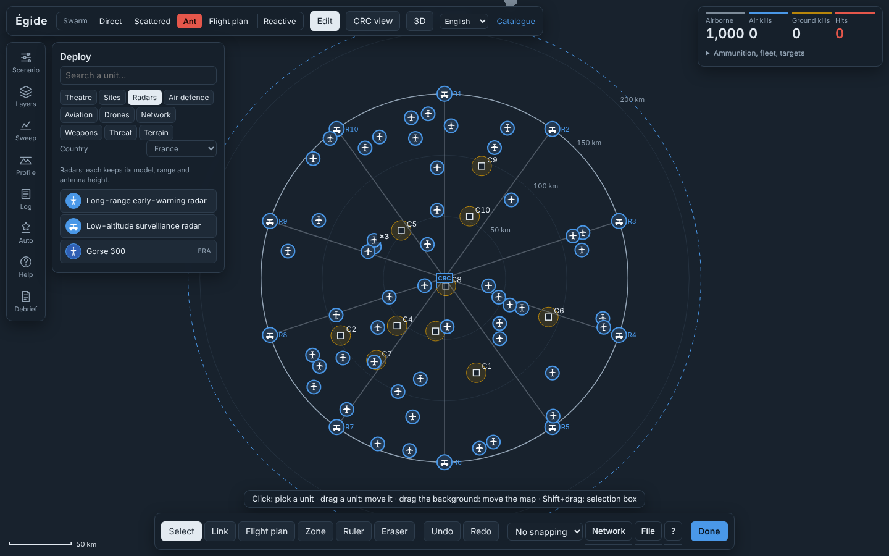

The **Layers** panel picks the base map (IGN aerial photographs by default, dark, OpenStreetMap or plan, hillshade or
3D terrain, 3D buildings, globe) and shows or hides each family of entities. What is hidden cannot be hovered,
inspected or edited.

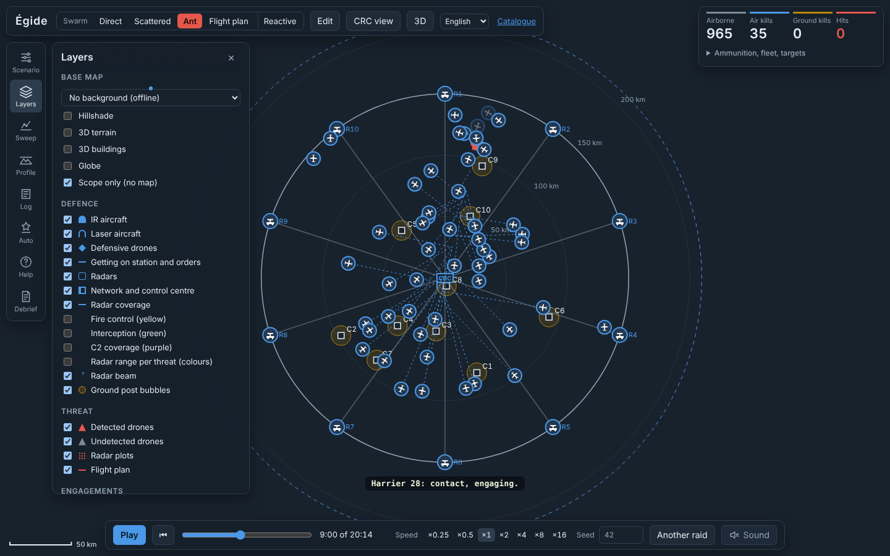

### Shortcuts

| Key | Action | Key | Action |
|---|---|---|---|
| Space | Play / pause | ← → | Back / forward 30 s |
| 1 to 8 | Open a panel | Esc | Close the panel or the inspector |
| E | Edit | V | CRC view |
| R | Reactive swarm on or off (outside the editor) | O | 3D view |
| M | Sound effects (outside the editor), ruler (in the editor) | | |
| S, C, R, K, L, P, Z | Select, Target, Radar, CRC, Link, Flight plan, Zone tools (in the editor) | Del | Erase the selection (in the editor) or take it out of service (during a raid) |
| X | Eraser: erase the clicked unit | Shift+click | While placing: erase the targeted unit (red cursor) |
| Ctrl+1 to 9 | Store the selection as a group | 1 to 9 | Recall the group (in the editor) |
| Ctrl+Z | Undo the last gesture | Right-click | Send the selection to the targeted point |
| Wheel | Zoom | Alt+drag, middle button | Move the view |

## 4 · Playing a raid

### Three enemy tactics, plus yours, and a swarm that reacts

<table>
<tr>
<td width="50%">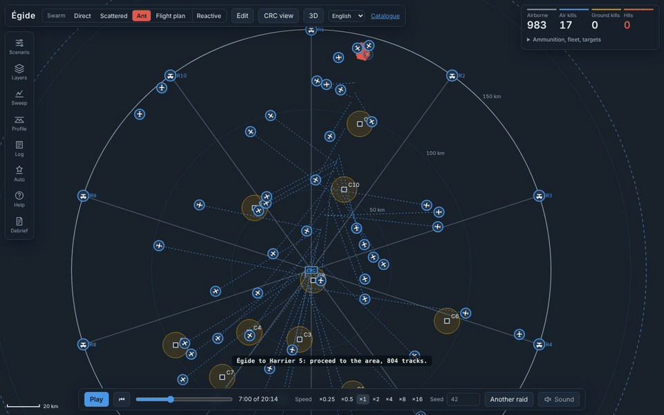</td>
<td width="50%">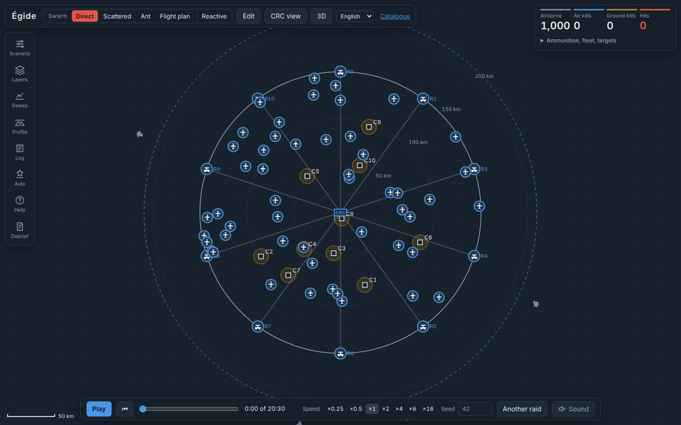</td>
</tr>
<tr>
<td><b>Ant</b>, zoomed in: the whole swarm enters through one corridor, bursts, then spreads over its targets while the aircraft converge.</td>
<td><b>Direct groups</b>: each group comes from a random heading, in a tight wave, straight at its target.</td>
</tr>
<tr>
<td colspan="2" align="center">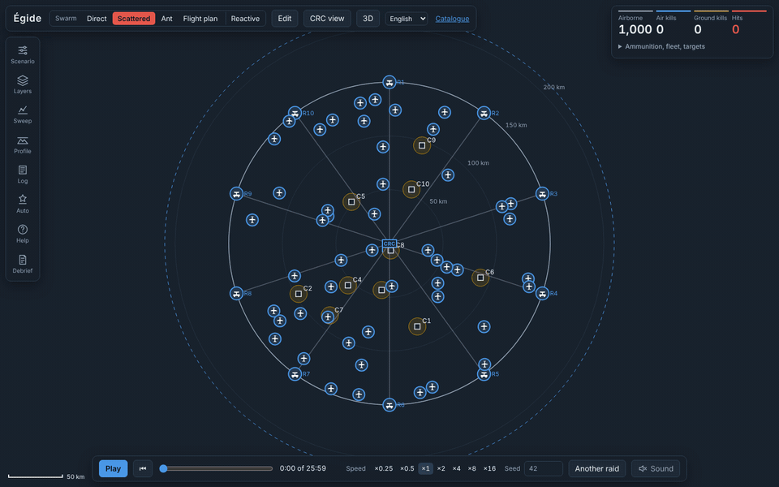</td>
</tr>
<tr>
<td colspan="2"><b>Scattered</b>: each drone comes alone, from any heading, with staggered departures. The easiest to defend: the aircraft find targets everywhere. The fourth tactic, <b>Flight plan</b>, follows the route you draw (editor tool P); the Profile panel plots its altitude above the terrain.</td>
</tr>
<tr>
<td colspan="2" align="center">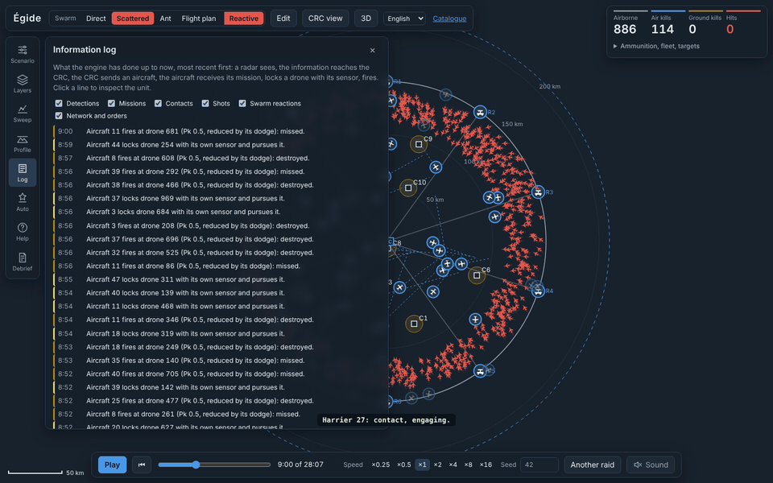</td>
</tr>
<tr>
<td colspan="2"><b>Reactive</b>, here on scattered, from 9:00 to 21:00: the drones bypass the sites where the swarm has already lost some of its own, then leave C3, which kills, for C9 and C10, already hit. The log, filtered on "Swarm reactions", tells each decision. The Reactive box combines with any tactic (see below).</td>
</tr>
</table>

### A swarm that reacts

Tick **Reactive** next to the tactics: the swarm stops flying straight and tries to maximise its hits. It does not see
your defence; it learns from its losses, which its mesh network shares with every drone within 2 s.

- **It shifts to the breach.** A drone whose target kills its fellows leaves it for a target already hit, where the
  swarm loses fewer drones, if the detour stays short. Engaged within 10 km of its target, it no longer switches.
- **It bypasses your defended sites.** When a site where the swarm has lost drones lies on its route, it skirts it
  tangentially, at a safe distance, without lengthening its route by more than 30 %.
- **It dodges your air fire.** Targeted by a rocket, it manoeuvres until impact: the shot's Pk drops by 30 %, at the
  cost of slower progress.

The summary counts reassignments, detours and dodged shots; the log ("Swarm reactions" family) groups the decisions;
click a drone: the inspector tells **why it changed course**.

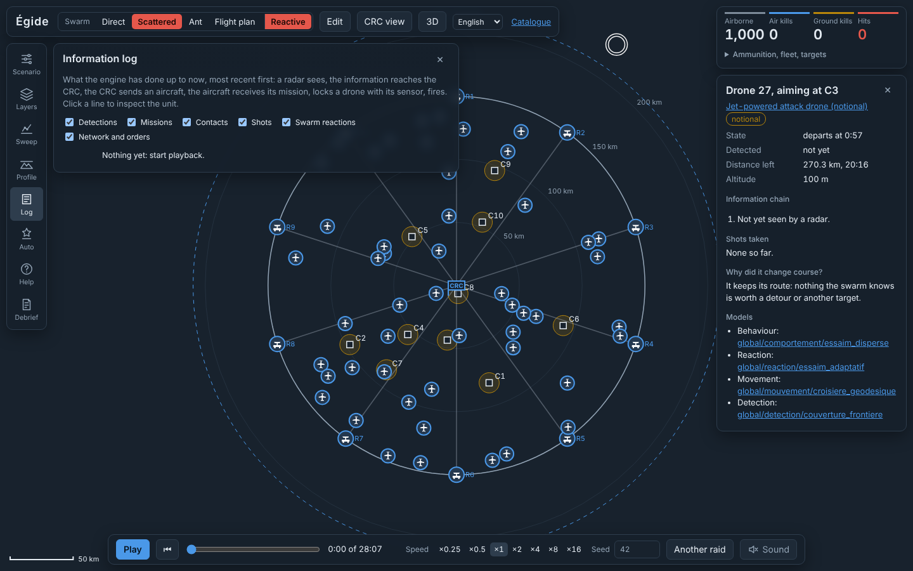

Same raid, same seed, with and without reaction (paired duel over 10 seeds of the reference scenario, 95 % CI):

| Tactic | Hits, inert swarm | With reaction |
|---|---|---|
| Ant | 362 | **+147 ± 80** (+41 %) |
| Direct | 486 | **+90 ± 68** (+18 %) |
| Scattered | 182 | **+115 ± 14** (+63 %) |

Scattered, the easiest tactic to defend, gains the most: its staggered departures give the last drones time to learn
from the first. The settings (network delay, radius of a defended site, thresholds, dodging) are the scenario's
`rouge.reaction_*` keys; model and assumptions: [docs/MODELE.md § 22](docs/MODELE.md).

### Setting up the scenario

The **Scenario** panel sets everything with sliders: number and speed of drones, aircraft per type, ground posts and
ammunition, defensive drones, CRC reaction delay, network, terrain. Each setting has its help sentence. It also holds
the **library** (repository scenarios and those stored in this browser), saved settings, scenario export and import,
and "Back to reference". With a private catalogue, the library also offers the scenarios of `prive/scenarios/`.

The swarm can be joined by **other threats**: the scenario's `rouge.groupes` block adds groups, each with its unit, its
departure, its target and its altitude or ballistic trajectory. A radar's range depends on the radar cross-section of
what it looks for (MODELE § 27), and the "Radar range per threat" layer draws it with one colour per class.

Same ant raid, same seed, at the end of the raid:

<table>
<tr>
<td width="50%">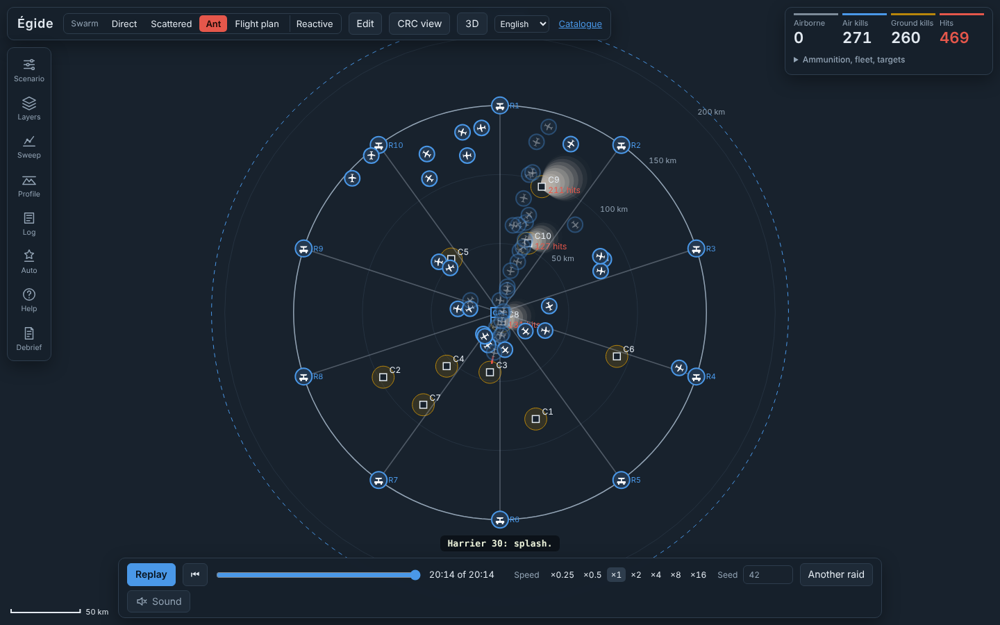</td>
<td width="50%">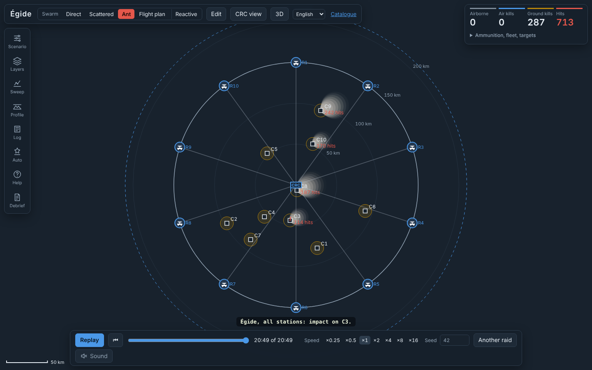</td>
</tr>
<tr><td>With 50 aircraft: <b>469 hits</b>.</td><td>Without aircraft: <b>713 hits</b>.</td></tr>
</table>

### Giving orders during a raid

Pause, then "Edit": the editor switches to **orders mode**. Select aircraft (click, Shift+click, box) then right-click
to send them from the CRC; select a radar, a CRC or a link then Del to take it out of service at that instant.
Everything is recorded in the scenario with its time, and the raid replays identically.

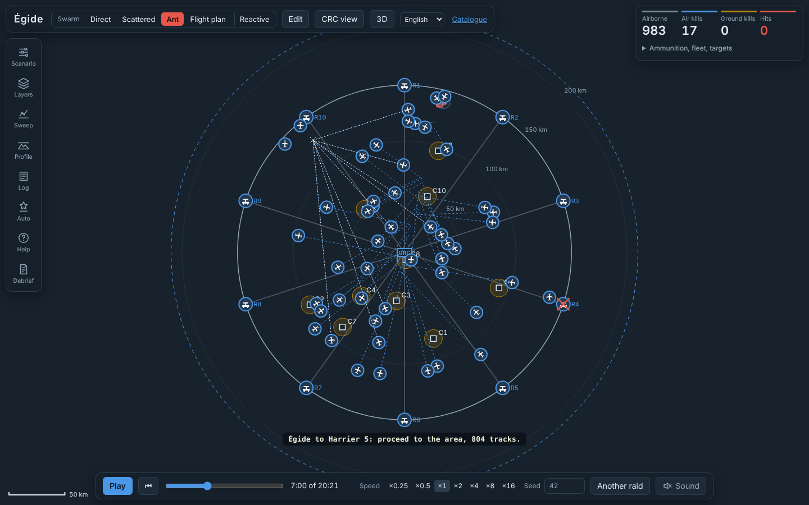

### Watching the raid in 3D

The **3D** button (key O) shows the same raid on the globe: same instant, same summary, same layers, over aerial
imagery and real terrain. Each flying unit is at its height, tied to the ground by a stem; radar coverages, ground
air-defence bubbles, links and shots are volumes. Altitudes (100 m over a 600 km theatre) can be stretched for display,
the factor staying written on screen: the computation does not depend on it.

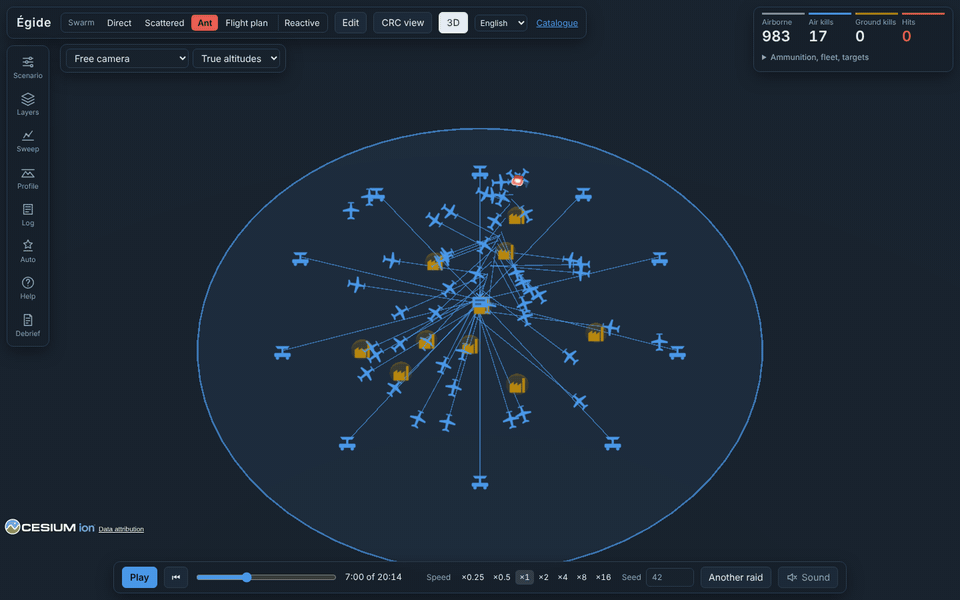

Near the camera, a unit that has a **3D model** shows it instead of its pictogram: at its real size, painted
(camouflage, panels, markings), never below 80 pixels. The 40 drones closest to the swarm are drawn as models too, and
"Follow selection" places itself 70 m from a unit that has one. The repository builds a notional model per class icon
(`node outils/modeles3d/classes.js`, unversioned files in `modeles/`); a private catalogue stores its own in
`prive/modeles/`. Stretched altitudes lengthen the terrain and flight heights, never the shape of the models.

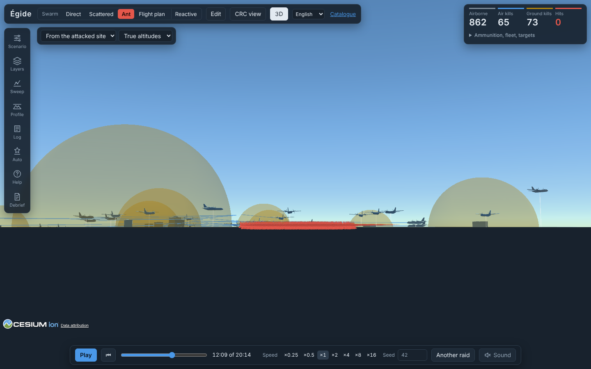

Six cameras to choose from: free, follow selection, from a radar, from the attacked site, commander view, top view.
Clicking a unit opens the same inspector as in 2D. For a 3D view without a network, prepare the theatre:

```sh
node outils/hors_ligne.js --lat 47 --lon 2.5 --rayon-km 300 --zoom-max 10   # into hors_ligne/, outside git
```

While this folder exists, the 3D view reads its tiles rather than the chosen base map. Respect each source's terms:
these tiles may not be redistributable.

### Scenario incidents

A radar hampered by weather, under maintenance or broken down, a link cut, a battery unavailable: a dated failure now
carries a **cause**, and a radar can keep a **reduced range** instead of stopping. The "Random incidents" button of the
Scenario panel draws a few from the raid seed (same seed, same incidents); "Remove incidents" takes them away. Each
start and end is announced on screen and written to the log. In 2D, a hampered radar has an orange ring and its
percentage, an unavailable battery a cross; in 3D, the element out of service fades. Rules:
[docs/MODELE.md § 29](docs/MODELE.md).

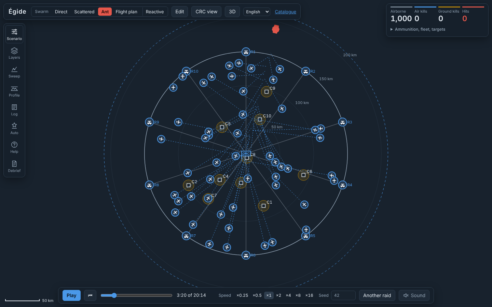

### Smoke, radio and sound effects

A hit target **smokes**, more so as hits pile up; on fire, its base burns. The log can also be read as subtitled
**radio messages**: "Égide to Faucon 1: join the area", "Busard 24: on target", "Égide, all stations: impact on C5"
(invented call signs, most important first). The **Sound** button of the playback bar (key M) turns on the **sound
effects**, off at start: explosions, missile and rocket launches, interceptions, radio, incident alert. They are
computed by `node outils/sons/generer.js`, with no borrowed sound. None of this touches the simulation
([docs/MODELE.md § 30](docs/MODELE.md)).

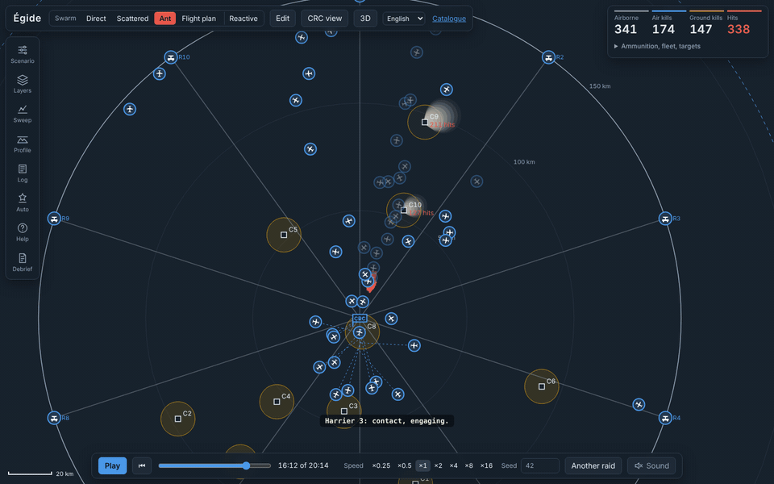

### The debriefing

At the end of the raid, the **Debrief** panel (key 8) opens by itself, in 2D as in 3D: a **grade** from A to E based on
the interception rate, the **cause** of each hit (undetected, unknown to control, never engaged, engaged but missed),
hits per target, each shooter's record with its posts out of ammunition, the timeline in 5-minute slices and at most
five quantified **weak points**. Everything is read from the raid log ([docs/MODELE.md § 28](docs/MODELE.md)).

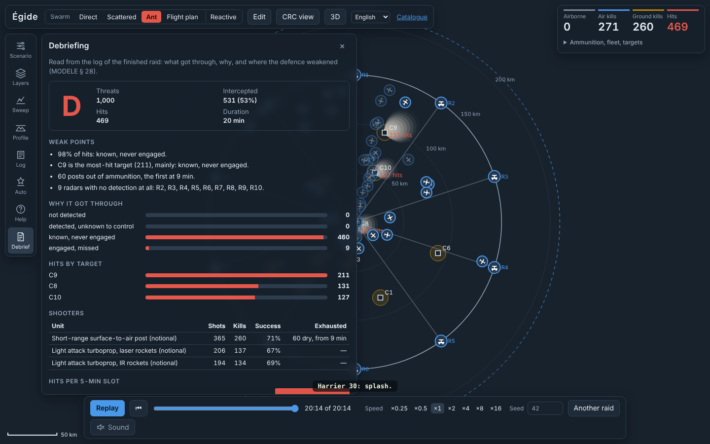

## 5 · Playing in Godot

Godot is a full interface in its own right, like the browser. The simulation remains single: a local Node server runs
it, Godot sends it orders and receives the state live. A played game is recorded with its orders and replays
identically (MODELE § 26).


`./jouer.command` (or `jouer.bat`) starts the server and the client. The game starts paused: Space to start.

| Control | Effect |
|---|---|
| Left click, box | Select vehicles; on a radar or a post, inspect it |
| Right click | Send the selection to the targeted point, also on the minimap |
| Ctrl+1 to 9, 1 to 9 | Store a group, recall it |
| WASD, arrows, screen edge; wheel | Scroll; zoom |
| + and − | Speed, from ×1 to ×60 |
| C, B | Coverage shown; fog |
| F5, F6 | Scenario editor; terrain editor |
| H | All controls |

On a Mac, the F keys may need the `fn` key.

**Editing the scenario (F5).** The game goes back to the initial instant. Pick a unit in the palette and place it on
the ground; links, flight plans, zones, eraser and undo are in the top bar. Each gesture goes through the same
computations as the browser editor, and the scenario restarts at each gesture.


**Editing the terrain (F6).** Four brushes: raise, lower, flatten, smooth. Saving applies the terrain to the scenario,
and the engine then computes radar masks and lines of sight on it. Going back to the game without saving discards the
edits.

Edited scenarios and terrains are saved under `prive/`, never in the repository. Keys, client checks and porting to
another engine are in [clients/README.md](clients/README.md). Limits: 3D units still generic, terrain edited without
imagery (altitude tints), fog drawn as discs without terrain masking.

## 6 · Deploying your forces

"Edit" at the start of the raid opens the **deployment editor**: the catalogue palette on the left, the sheet of the
selected unit on the right, the toolbar at the bottom and, above it, a hint telling at any time what the next click
does.

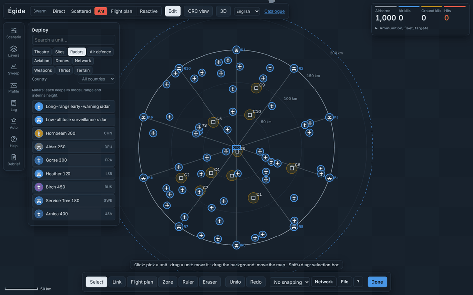

### Placing units

The palette sorts the catalogue into tabs (Theatre, Sites, Radars, Air defence, Aviation, Drones, Network, Weapons,
Threat, Terrain), with a search by name; each unit shows its icon and country, and the "Country" filter only shows the
units of one country (and the generic ones). The Theatre tab moves the centre of the map and sets its extent. To place
a unit:

- **click it in the palette, then click the map**, as many times as needed; right-click or Esc to finish;
- **or drag it** from the palette onto the map.

While a placing tool is armed, dragging a unit moves it and dragging the background moves the map: only a click
without movement places.

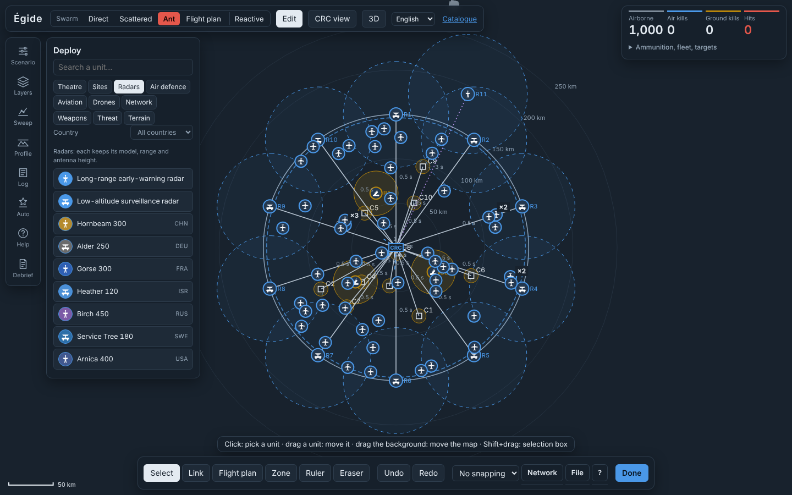

| Family | What a drop does |
|---|---|
| Infrastructure | One more **sensitive site** to defend (it receives its share of the common ground posts) or **C2 centre** |
| Sensors | A radar **of this model**: each radar keeps its antenna height and range. The first drop turns the "border" ring into radars placed one by one |
| Ground defence | A **battery** of this model, with its own bubble and ammunition (40 by default) |
| Aviation, Defensive drones | One vehicle orbiting at the dropped point, or several ("Vehicles per drop") in a small circle around it. Each model forms a group, which grows with each drop |
| Network | **Click a means**, then the two units to link; **drag it onto a unit** to equip it (see below) |
| Weapons | To drop **on an aircraft or a defensive drone**: its whole group changes payload |
| Threat, Terrain | The swarm's drone model, or the theatre's terrain, wherever it is dropped |

The toolbar keeps the quick gestures: **Select** (S) to pick a unit and drag it, Shift+drag for a selection box;
**Link** (L); **Flight plan** (P); **Zone** (Z), one click per vertex, double-click or Enter to close, which counts
incursions; **Ruler** (M) and **Eraser** (X). Keys **C**, **R** and **K** place a default target, radar or CRC. Del
erases the selection, Ctrl+Z undoes, Ctrl+1 to 9 stores a group and 1 to 9 recalls it. Dragging the background moves
the map; the view never moves by itself, even when a far-away radar enlarges the theatre. The raid is only recomputed
when leaving the editor: gestures stay instant.

**Erasing**: while placing, hold Shift: the cursor turns from a green "+ unit" to a red "− Erase" and the targeted unit
is crossed out; Shift+click erases it. The **Eraser** tool (X) does the same at each click. **Clear all** empties the
map — radars, batteries, posts, vehicles, other C2s, links, means, zones, flight plan, orders — to start from scratch;
the main CRC and one site to defend remain, and Ctrl+Z brings everything back.

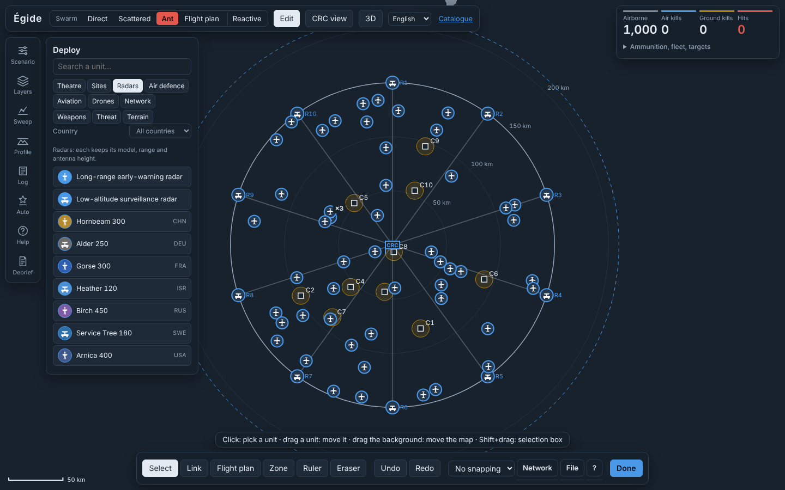

### Deployment aids

While editing, the view stays top-down, north up, and gets its tilt back on exit. The **Ruler** (key M) measures
distance and heading along the geodesic; **snapping** aligns placements on a 1 to 25 km grid or on nearby units.
Before placing, a radar shows its range against the swarm, a battery its bubble, and a link being drawn its range, in
red if the other end is too far. A "×3" badge flags stacked aircraft.

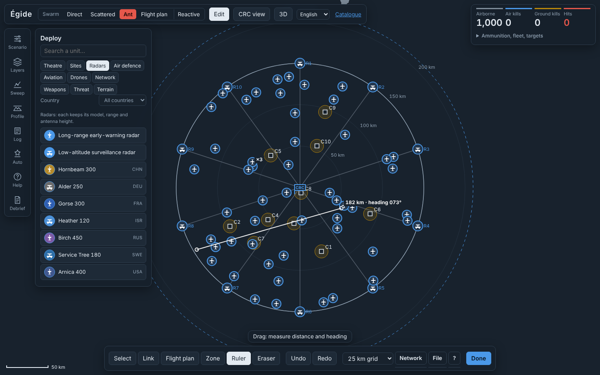

### Equipping and linking

Each unit can declare its **means of communication**: wire, V/UHF radio, satellite, optical (catalogue
`unites/liaisons/`, each with its latency, range and line-of-sight requirement). Drag a means onto the unit, or tick it
in its sheet. These boxes feed "Link automatically"; a unit that declares none accepts any means.

- **Link** (L), or click a means in the Network tab: click one unit, then the other. The link takes **the chosen
  means**, shown next to the Link button; it complements the declared equipment if needed. Between two ground units, it
  is refused if the distance exceeds the range, and the message gives both figures. A click beside keeps the first end;
  Esc cancels.
- **Link automatically**: each equipped unit is linked to each C2 it shares a means in range with, the fastest one;
  the C2s are linked to each other. Range accounts for the horizon: a ground radio on 15 m masts only carries about
  thirty kilometres, whereas an aircraft at 1,000 m is heard at 140 km. Units left off the network are named; terrain
  is checked during the simulation.
- **Full network** goes back to "everyone talks to everyone, with no delay".

### Setting a unit: the sheet

Select a unit (or several, up to four sheets): its sheet opens on the right.

| Unit | What the sheet sets |
|---|---|
| Radar | Its model (or the one common to all), its means of communication |
| Battery | Its model, its ammunition, its ground-fire algorithm, its means |
| Aircraft or defensive drone | For its whole group: model, number, altitude, weapon, movement and fire algorithms, means |
| Main CRC | Allocation and tracking algorithms, reaction delay, means |
| Other C2 | Its name, its own allocation algorithm (or the main one's), its means |
| Sensitive site | The means of its ground posts |
| Link | Its means |

For each algorithm, "inherited" keeps the model's; a choice replaces it for this unit or group only. The algorithms
offered are those of the `algos/` folder (and of your private catalogue).

The sheet also lists the unit's **connections**, sorted by family of means (wire, radio, satellite, optical): the
other end, the means, the distance against the range, the latency and the state (active, out of range, masked, failed).

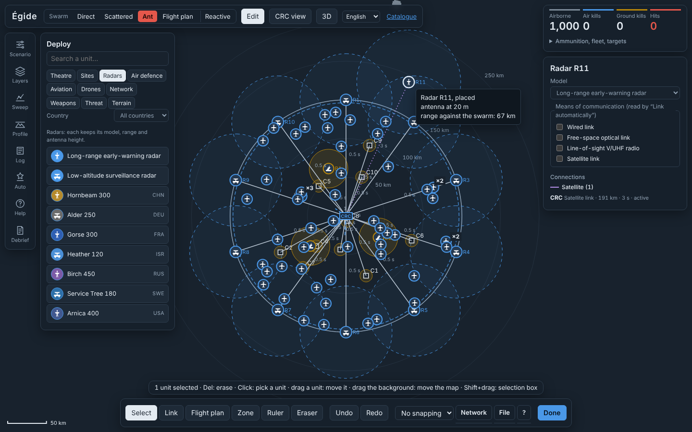

### Saving and reloading

At the top of the palette, give the deployment a name:

- **Save** stores it in this browser's library; it reloads from the Library list of the Scenario panel;
- **Export** downloads the complete scenario as JSON, to archive, version or share;
- **Import** reloads an exported file (also from the Scenario panel).

Each gesture and each sheet setting is a change to the scenario, like a slider: undo, export, the library and
reproducibility by seed apply to everything you deploy.

## 7 · The information network

By default, everyone talks to everyone, with no delay. As soon as the first link is drawn, the network becomes
explicit, and information takes time and can be lost:

- a C2 only learns of a drone after the latency of the path from the radar that sees it; an unlinked radar sees for
  nothing;
- its instructions, like your orders, only reach the aircraft after the latency of its link; an aircraft out of radio
  range is no longer assigned (red cross);
- failures are dated; the CRC can become a target of the swarm (Scenario panel), destroyed at the first hit.

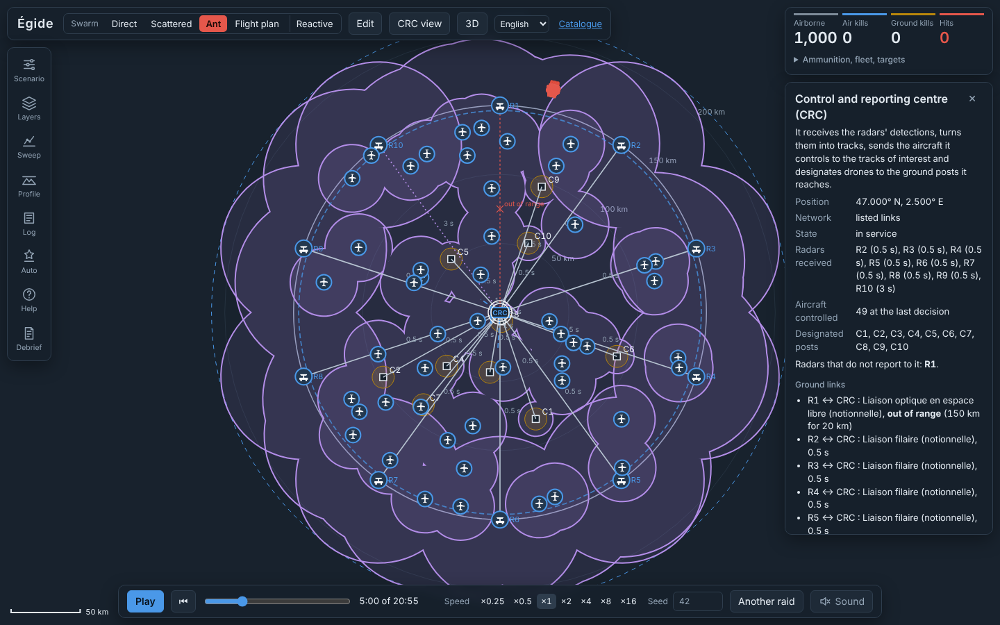

### Seeing information flow

Blue pulse from a radar to the C2 with the number of drones reported (red and stopped if the radar is not linked),
white pulse from the C2 to the aircraft it sends, white circle when the mission is received, yellow dashes when an
aircraft locks a drone with its own sensor.

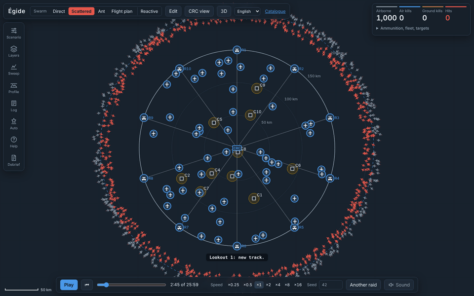

The **Log** panel tells the same story in sentences, filterable; a drone's inspector gives the whole chain: seen by
such radar, known to the C2, reaction delay, locked, fired at.

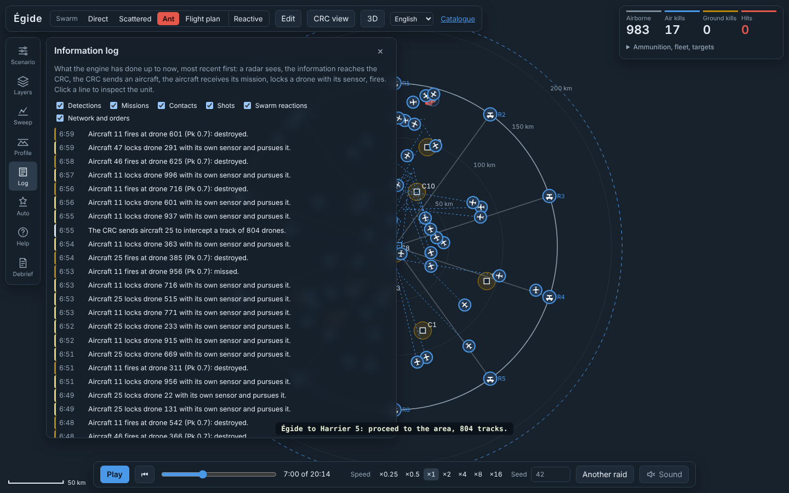

### Several centres

Each C2 receives its radars, turns them into tracks, sends the aircraft it reaches fastest and designates drones to
the ground posts it reaches. It exchanges its tracks with the others over the network and takes over the aircraft of a
centre that falls. A designated ground post fires as soon as the drone enters its bubble; alone, it must first acquire
it (10 s, notional).

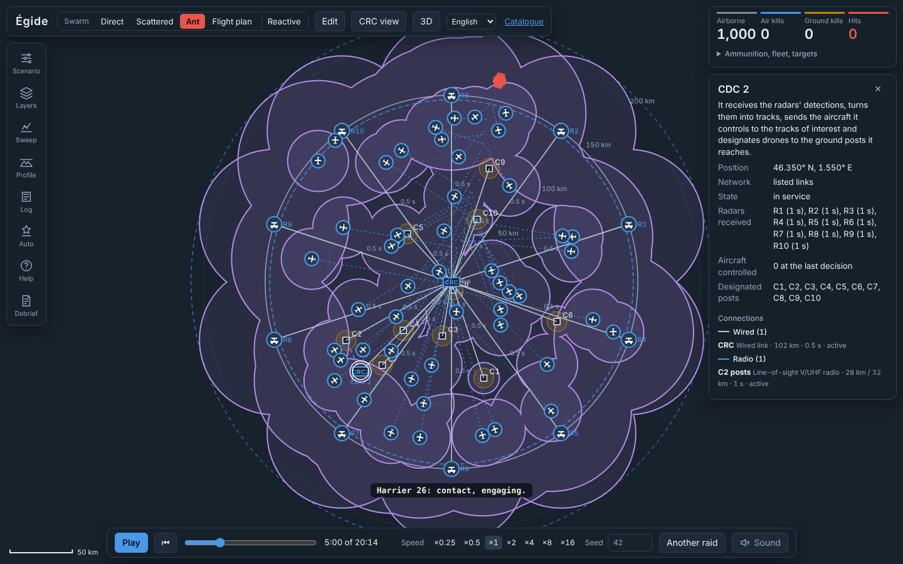

| Reference scenario with links, 8 raids | Ground kills | Hits |
|---|---|---|
| Ground posts linked to the CRC | 312 | 432 ± 52 |
| Ground posts alone | 231 | 515 ± 42 |

**CRC view** (V): the screen only shows what the centre knows — the drones it knows of, grouped into tracks by its
tracking algorithm. Ground truth comes back with the same button.

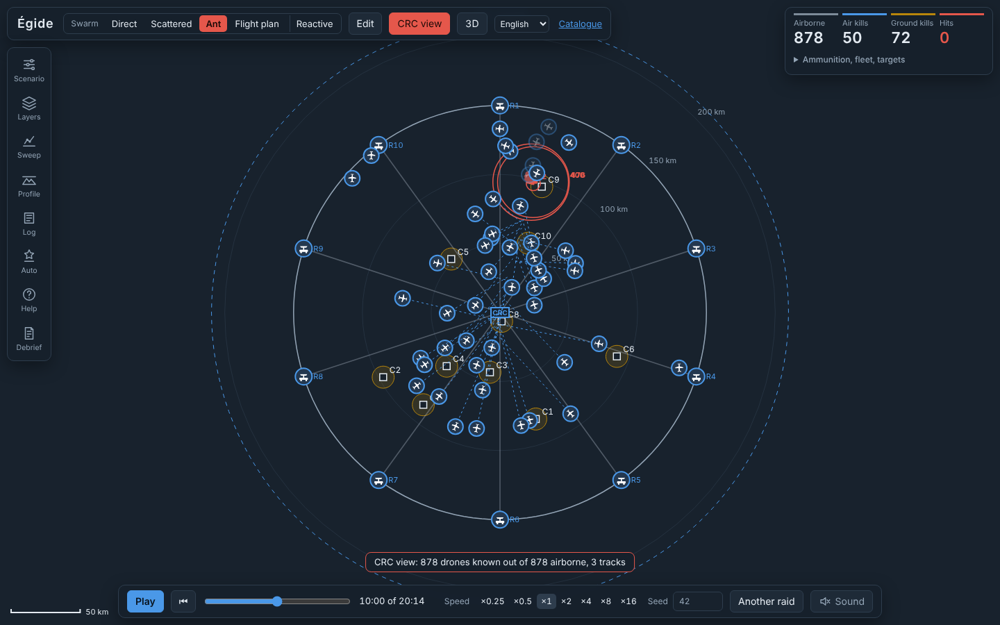

The **fog of war** is rendered there: each drone appears as a track, at the last plot received, updated every 10 s and
offset by an error of at most 300 m, inside an uncertainty circle that grows with the plot's age. The trail only keeps
plots already received. Only the display changes: the simulation keeps the true positions
([docs/MODELE.md § 31](docs/MODELE.md)).

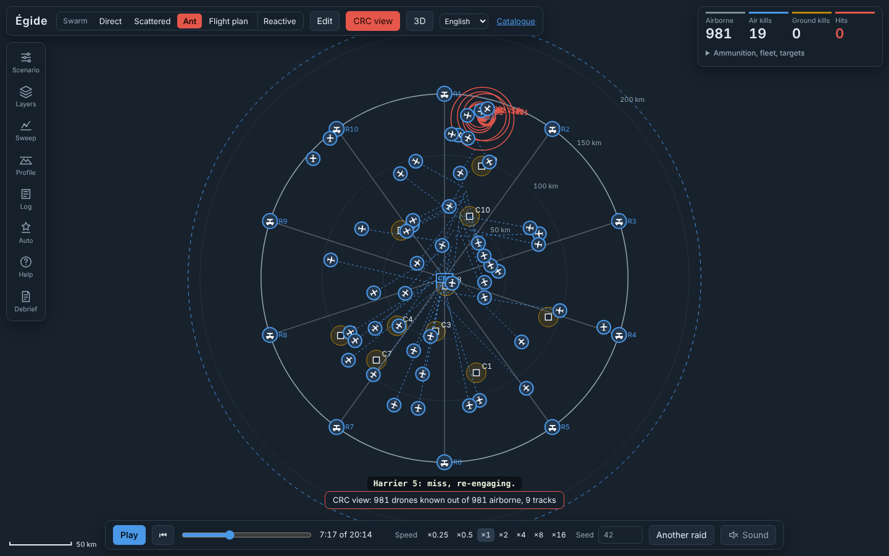

### Coverages: detect, control fire, intercept

Each object carries up to three envelopes, computed once by the engine and read by every interface (MODELE § 25):
a radar's **detection**, **fire control** (the distance at which an effector tracks its target well enough to fire)
and **interception**. Fire control is a real constraint: an effector does not fire beyond it. A C2's **resultant**
merges the envelopes of the objects linked to it. The Layers panel shows fire control and resultant; the inspected
object always shows its own.

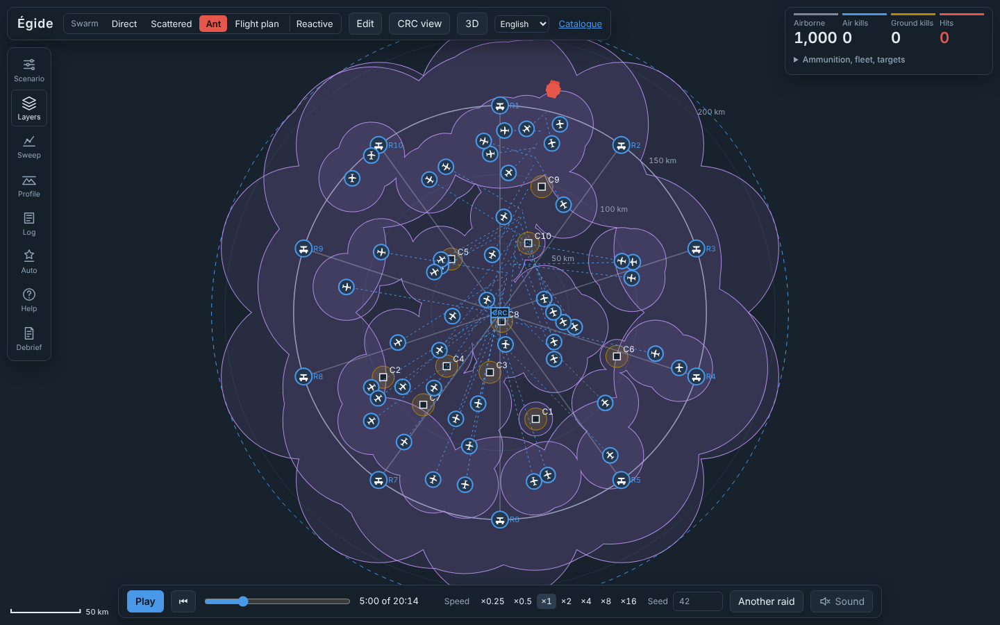

## 8 · Defensive drones

Three notional families, under the same rules as aircraft (mission from the centre, getting on station, lock,
engagement): **armed drones** (two short-range charges), **single-use interceptors** (they ram their target and are
lost), **jammers** (neutralisation at a constant rate within a radius, with no signal model). Place them from the
palette, or set their number in the Scenario panel.

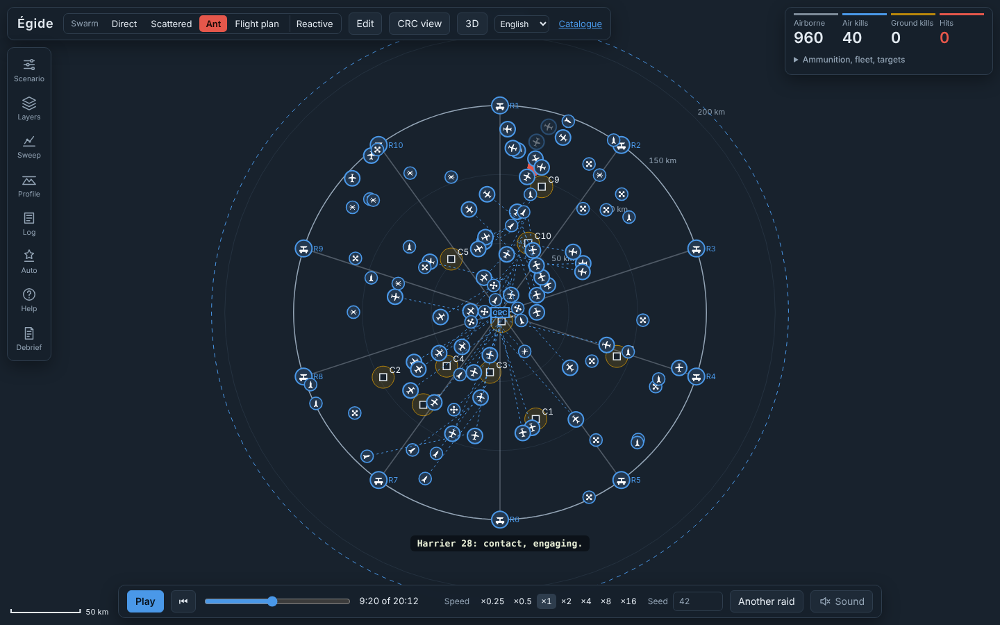

| Added to the 50 aircraft, ant tactic, 6 raids | Hits |
|---|---|
| Reference | 404 ± 51 |
| + 100 armed drones | 390 ± 52 |
| + 200 interceptors | 364 ± 51 |
| + 30 jammers | 134 ± 98 (notional jamming parameter, to be calibrated) |

## 9 · Terrain

A catalogue terrain, chosen in the Scenario panel or dropped from the palette, gives the engine the theatre's relief:
each radar has its horizon mask, a drone flying low behind a ridge is not seen, and radio and optical links require
line of sight. The screen draws each radar's real coverage.

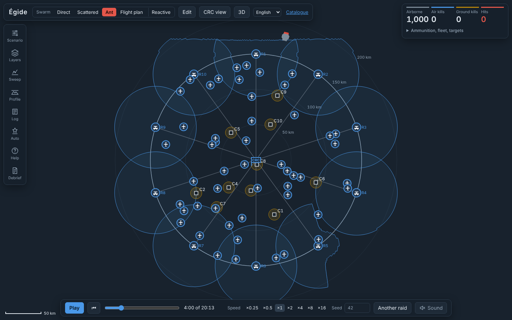

The repository ships a synthetic demonstration terrain. For a theatre's real relief, from a machine with a network:

```sh
node outils/terrain.js --nom centre_france --lat 47 --lon 2.5 --rayon_km 320 --pas_km 1
node outils/indexer.js
```

The terrain is then a file: the engine works offline.

## 10 · Automatic configuration

The **Auto** panel proposes a complete deployment from three questions:

1. **The threats** to consider: tactics and number of drones;
2. **The available assets**: radars, C2s, sites, posts, ammunition, aircraft and defensive drones per type;
3. **The area**: a country (Natural Earth borders) or an area drawn with the Zone tool.

"Run" builds the scenario (protected zone, well-spread sites and centres, radars along the border, aircraft and
defensive drones placed) and searches in simulation for the layout that minimises hits, all threats combined. A
progress bar gives the progress and the time left; "Stop" interrupts. The result is compared with a uniform layout with
its confidence interval, then applied, stored in the library or exported — and can then be touched up by hand in the
editor.

<table>
<tr>
<td width="50%">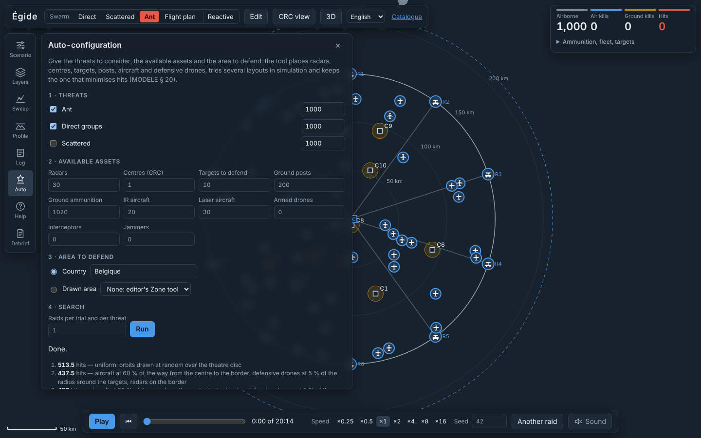</td>
<td width="50%">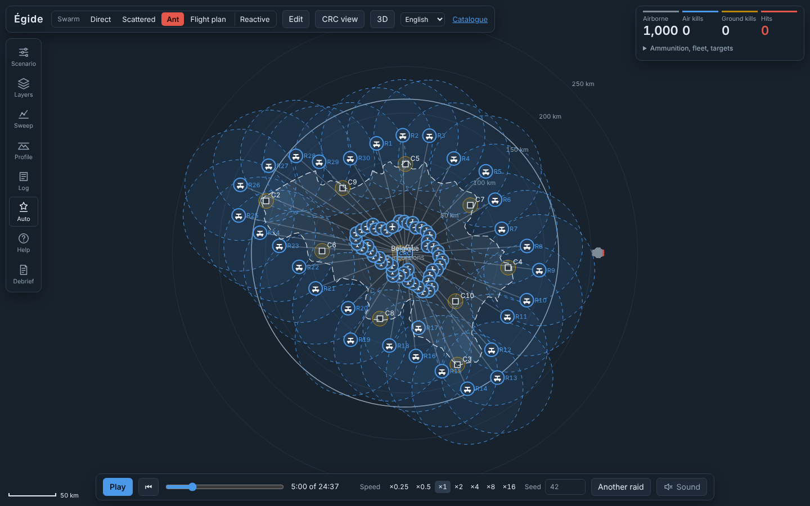</td>
</tr>
</table>

```sh
node outils/frontieres.js                                     # once: Natural Earth borders (public domain)
node src/autoconfig.js --pays FRA --menaces fourmi:1000,direct:1000 --radars 30 --cibles 12 --centres 3 \
  --postes 400 --munitions 2000 --avions 20,30,40,0,10 --tirages 3     # writes scenarios/auto_france.json
```

## 11 · Understanding: inspector and catalogue

Clicking an entity opens the **inspector**, updated live: for an aircraft, why the centre sent it there (track kept,
score, delay, alternatives discarded) and over which link it reaches it; for a drone, each shot taken, its survival
probability Π(1 − Pk) and the cause of its loss; for a site, its defence; for a radar, its range, its terrain masking
and its latency to the C2; for a C2, the state of the whole network.

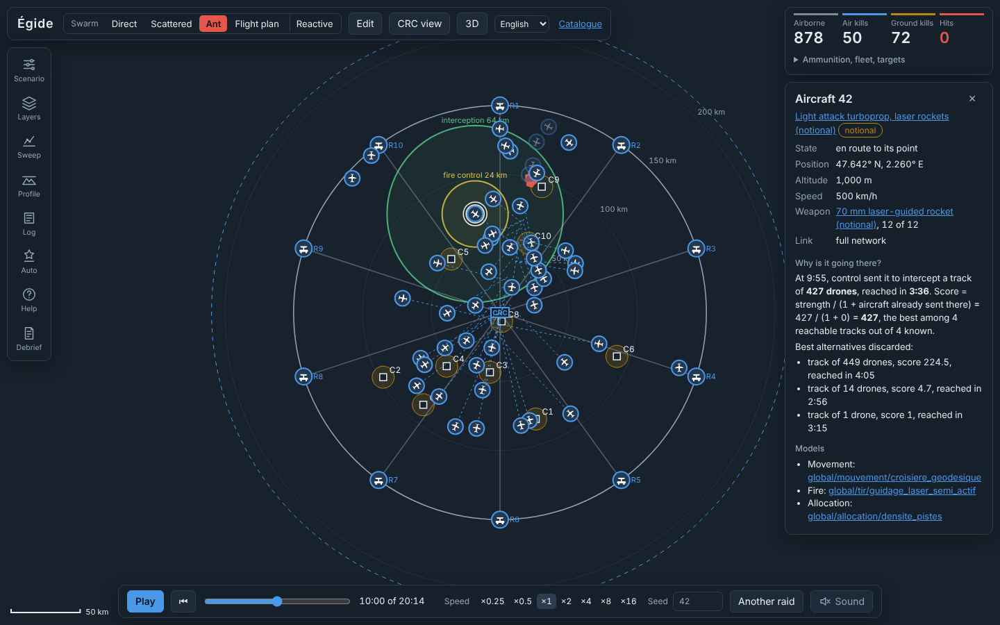

The **Catalogue** link opens the explorer: one sheet per unit (fidelity, lineage, sources, parameters with the ancestor
that sets them, algorithms) and per algorithm (equations, assumptions, validity domain, references, code, users).

<table>
<tr>
<td width="50%">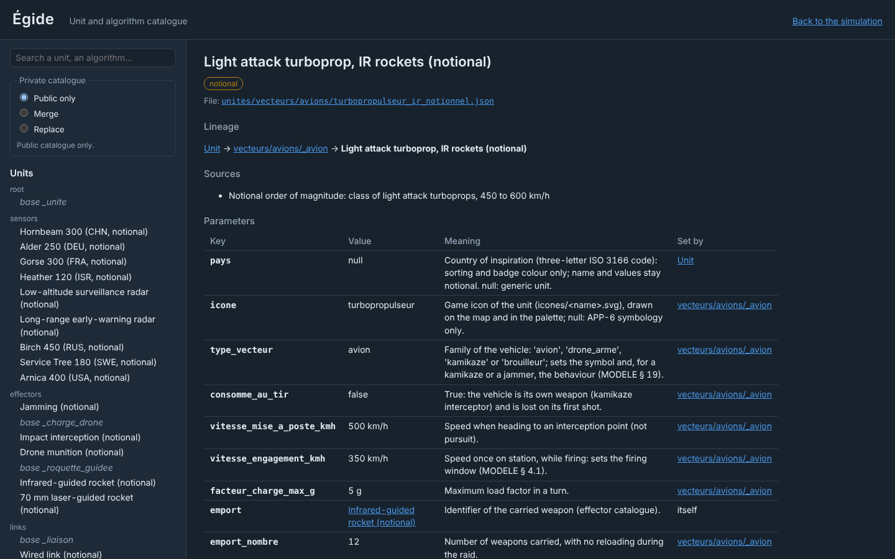</td>
<td width="50%">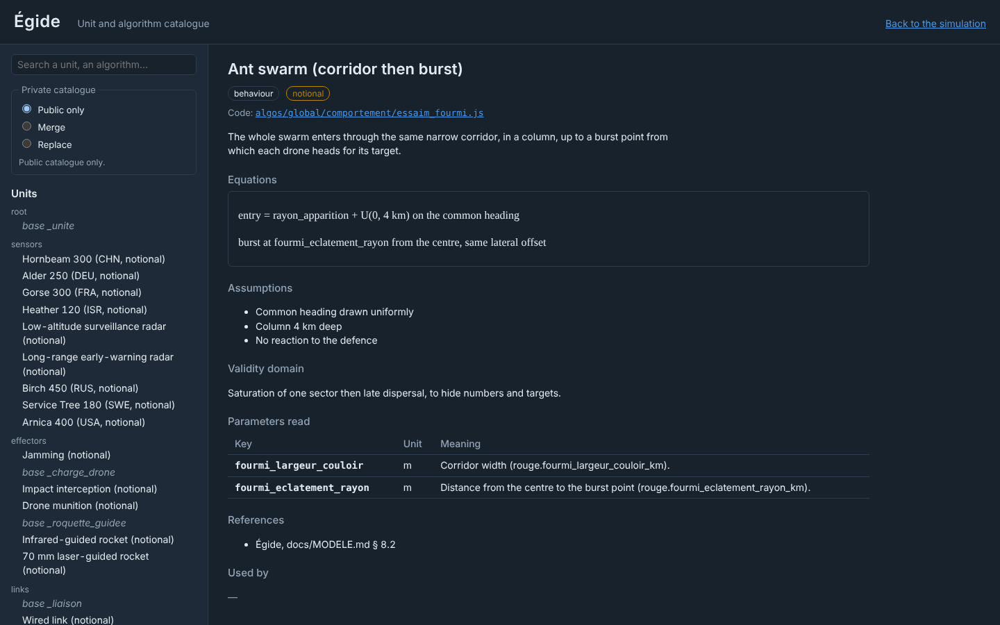</td>
</tr>
</table>

The page's **Private catalogue** box imports your units from `prive/`: **Public only**, **Merge** (they are added to
the public units) or **Replace** (they take the place of the public units of their folders; terrains, weapons and base
classes remain). The choice is remembered by the browser and also applies to the simulation palette (see
[§ 13](#13--extending-units-algorithms-maps)).

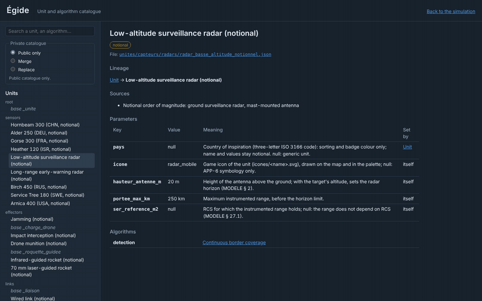

## 12 · Analysing and proving

A raid is one draw: only a series of raids tells whether one deployment does better than another.

### Sweep

The **Sweep** panel varies a setting, replays the raid over several seeds per value and plots each quantity with its
confidence interval, computed in the background.

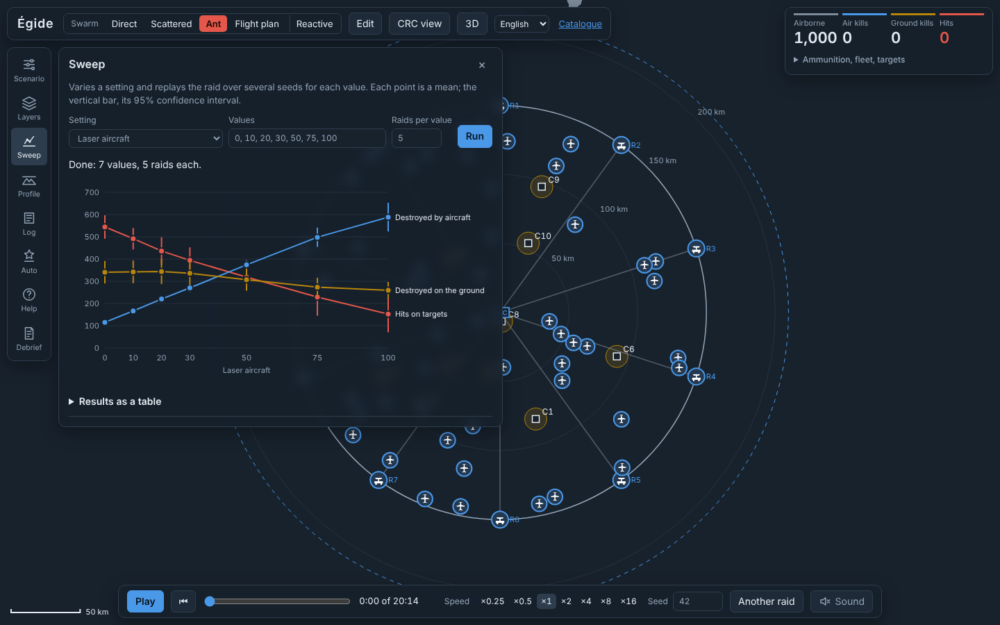

### Command line

Every scenario value has a path (`bleu.avions.1.nombre`, `rouge.surcharges.vitesse_kmh`…) that can be set as an option:

```sh
node src/campagne.js                                            # reference scenario, 50 raids
node src/campagne.js --scenario scenarios/mon_deploiement.json  # a scenario exported from the interface
node src/campagne.js --tirages 200 --rouge.tactique direct      # any value is set by its path
node src/campagne.js --balayer bleu.avions.1.nombre=0,10,30,60  # one campaign per value
uv run --with matplotlib python -m analyse.abaques              # analytical charts and summary
```

<table>
<tr>
<td width="50%">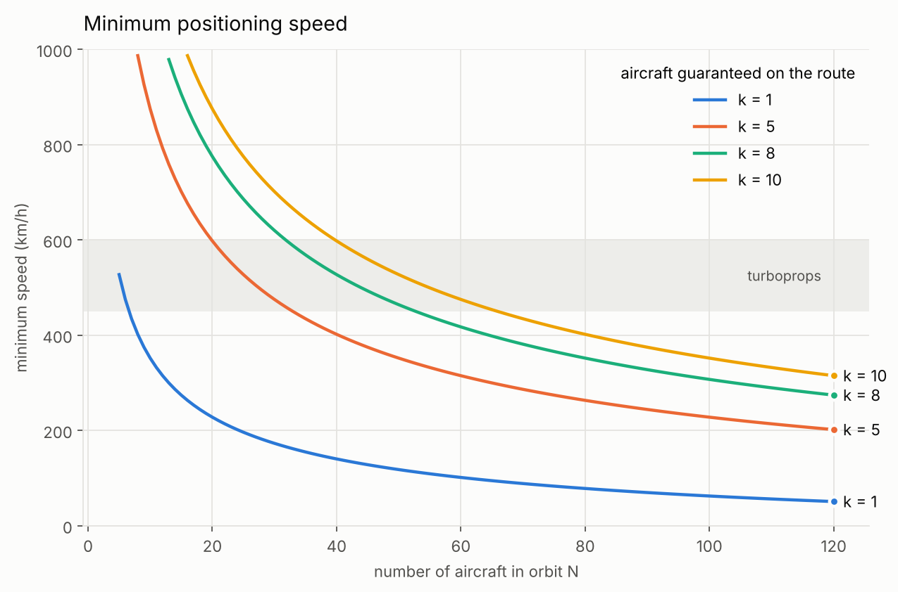</td>
<td width="50%">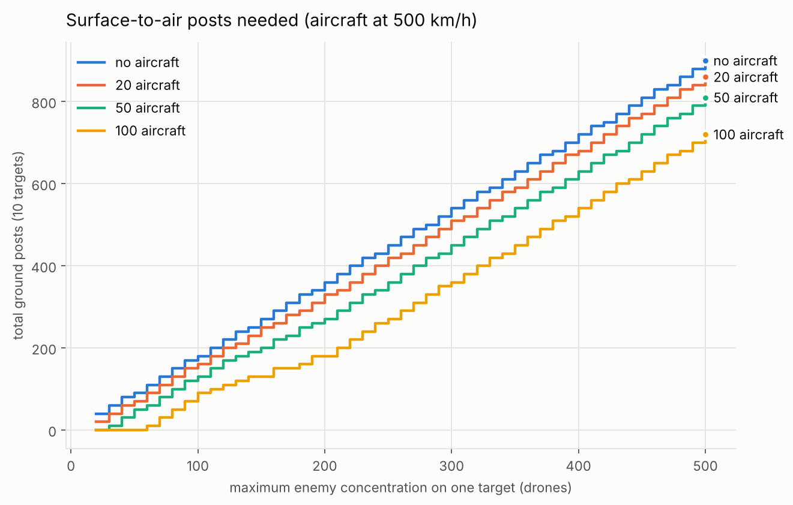</td>
</tr>
<tr>
<td>Minimum speed to get on station to guarantee k aircraft on any route.</td>
<td>Ground posts needed versus the enemy concentration, without aircraft then with 20, 50 and 100 aircraft.</td>
</tr>
</table>

### Proof tools

Each result carries its **fingerprint** (SHA-256 of the scenario, the units, the algorithms in play and the engine
code) and its differences from the reference scenario: two results with the same fingerprint and seeds are identical
to the bit.

```sh
node src/preuve.js dossier                                   # Markdown dossier: results, convergence, models, limits
node src/preuve.js convergence --pas 2,1,0.5,0.25 --tirages 10
node src/preuve.js duel --variante rouge.tactique=direct     # A against B, same seeds, difference and verdict
node src/preuve.js morris --facteur bleu.avions.1.nombre=0:60 --facteur bleu.sol.nombre=0:200
node src/preuve.js empreinte
```

- **Convergence**: the campaign replayed at several time steps, each step compared with the finest, draw by draw.
- **A/B duel**: two variants on the same seeds; paired difference, confidence interval, measured gain from common
  random numbers.
- **Morris**: ranking of settings by influence (μ*, μ, σ) and noise threshold; it showed, for example, that the
  spread of departures has no effect outside the scattered tactic.

## 13 · Extending: units, algorithms, maps

Everything the palette offers comes from files; adding one is enough for it to appear.

```
unites/<family>/<class>/<unit>.json       one unit per file, inheritance through herite_de, every key documented
icones/<silhouette>.svg                   game icons of the units
unites/liaisons/<means>.json              means of communication: latency, range, line of sight
unites/terrains/<terrain>.json            terrains: altitude grids (node outils/terrain.js)
algos/global/<role>/<algo>.js             one algorithm per module: "meta" sheet + role functions, no imports
cartes/fonds|relief|batiments/<source>.json   one map source per file, attribution mandatory
prive/unites/…  prive/algos/…             your private catalogue (ignored by git), identifiers prefixed "prive/"
prive/icones/<name>.svg                   icons of your private units, cited by "icone": "prive/<name>"
prive/scenarios/                          scenarios saved from Godot (ignored by git)
clients/godot/                            the game client (Godot 4, GDScript)
scenarios/                                JSON scenarios, every key documented
schemas/                                  JSON schemas of the files (generated by node outils/indexer.js)
langues/<code>.json                       interface texts, one file per language (en, fr)
hors_ligne/                               tiles prepared for the offline 3D view (ignored by git)
```

- **Units**: a file only states what differs from its parent (`herite_de`); values are written in the trade's units
  (`vitesse_kmh`, `portee_km`, `acquisition_s`…) and converted to SI when read.
- **Algorithms**: each decision (behaviour, reaction, movement, detection, tracking, allocation, fire, ground fire) is
  an interchangeable module, chosen by a unit, a group, a centre or the scenario. It exports its `meta` sheet and its
  role functions, imports nothing and receives geodesy and seeded randomness: it is pure and reproducible.
  `algos/global/allocation/plus_proche.js` is a commented example.
- **Countries and icons**: `pays` (three-letter ISO code) classifies the unit and colours its disc; `icone` picks a
  silhouette from `icones/` (white SVG, 64 × 64, top-down).
- **Private catalogue**: `prive/` holds your real units and algorithms, outside the public repository. A private unit
  goes into an engine family (`prive/vecteurs/avions/…`, `prive/sites/postes/…`) and inherits from its public base,
  which brings it its algorithms: it then plays like a public unit.
- **Languages**: every interface text lives in `langues/<code>.json`; adding a language means adding one file (tests
  check that it has every key, parameter and markup of the English file).

After any addition: `node outils/indexer.js`, then `npm test` — conformance checks every file dropped in by itself. The
indexer also writes `prive/unites/index.json` (outside git), read by the private catalogue import: choose **Merge** or
**Replace** on the Catalogue page, and your units appear in the palette, can be dropped and fight like the others.

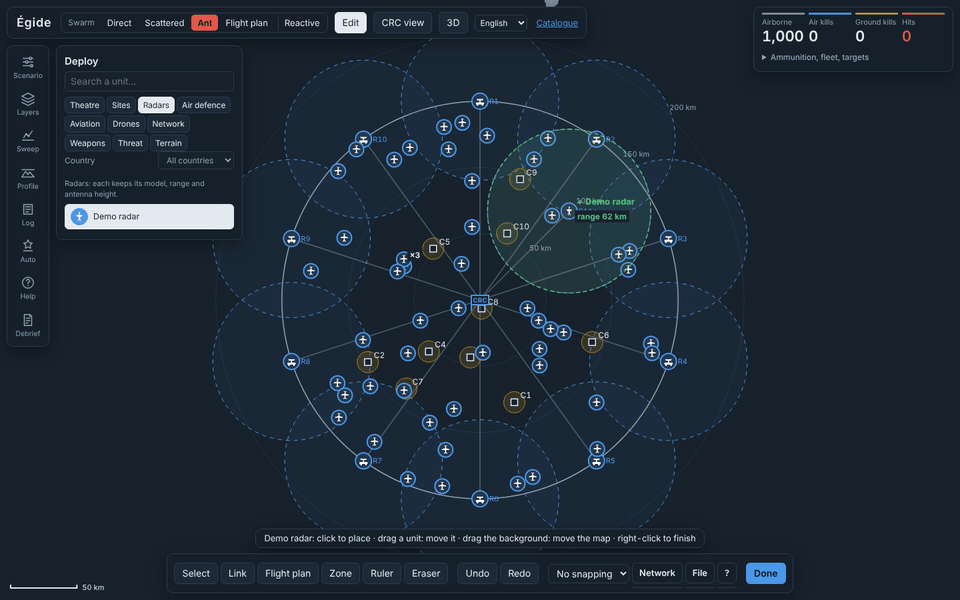

To measure the effect of a change: `node src/preuve.js duel --variante bleu.conduite.allocation=global/allocation/plus_proche`.

**From an external tool** (unit modeller, algorithm generator, export from another simulator): the exact format of each
file is set in [docs/FORMATS.md](docs/FORMATS.md), with JSON schemas per family in `schemas/` (generated from the
catalogue) and a validator that applies the conformance rules:

```sh
node outils/valider.js prive/unites/capteurs/radars/mon_radar.json prive/algos/allocation/mon_algo.js
node outils/valider.js --json …     # machine report, exit code 0 or 1
```

**The complete guide is in [docs/CATALOGUE.md](docs/CATALOGUE.md)**: unit families, inheritance, suffixes,
overrides, roles and contract of algorithms, step-by-step example, private catalogue, conformance, maps, terrains,
links, deployment keys, and proving a change.

## 14 · Frequently asked questions

**The page stays blank, or shows a module error.** It must be served by `lancer.command`, `lancer.bat` or
`python3 -m http.server`: a file opened directly (`file://`) does not load JavaScript modules.

**The base map is empty.** It comes from the Internet. Offline, tick "Scope only" in the Layers panel: the simulation
does not depend on it.

**"Scenario rejected: …".** The message names the faulty key (unknown unit, override of a key the unit does not have,
link to a node that no longer exists). Ctrl+Z undoes the last gesture; "Back to reference" starts again.

**F5 or F6 does nothing in Godot.** On a Mac, these keys may control the system: try with `fn`.

**My deployment has disappeared.** Saved deployments live in this browser's storage: another browser, a private window
or cleared data does not see them. Export what matters.

**"Drop it on an already placed unit".** A means of communication or a weapon is dropped on a unit, not into empty
space; and a unit does not receive the same means twice.

**A link is refused.** The chosen means does not reach far enough: the message gives its range and the distance. A
line-of-sight radio hardly exceeds 30 km on the ground; pick a longer means, next to the Link button.

**A unit stays "off the network" after "Link automatically".** No C2 shares a means in range with it: a ground radio
only reaches the masts' horizon; add wire or satellite, or bring a C2 closer.

**"Choose an area" in Auto.** Country borders are downloaded once with `node outils/frontieres.js`; otherwise, draw an
area with the editor's Zone tool.

**The reactive swarm does not change target early in the raid.** That is intended: it only switches to a target
already hit, a proven breach. Until a drone has got through, it bypasses your sites but keeps its targets; switching
blindly to targets as well defended as the others made it lose hits (MODELE § 22.2).

**The interface is in English, I want French (or the reverse).** Use the language selector in the top bar; the choice
is remembered. `?lang=fr` or `?lang=en` in the address forces a language.

## 15 · What the reference scenario shows

1,000 drones at 800 km/h, 10 sites, 200 ground posts, 50 aircraft at 500 km/h; 30 raids per tactic, mean and 95 %
confidence interval:

| Swarm tactic | Hits without aircraft | Hits with 50 aircraft | Destroyed by aircraft |
|---|---|---|---|
| Direct groups | 650 ± 21 | 395 ± 27 | 257 |
| Scattered | 524 ± 8 | **187 ± 11** | 407 |
| Ant (tight corridor then burst) | 668 ± 19 | 401 ± 25 | 272 |

- Aircraft divide the hits by 1.6 to 2.8. The ant tactic is the most effective for the attacker: the tight corridor
  saturates each aircraft on one pass, and the late burst forces the fleet to split up.
- Against compact groups, the limit is the rate of fire per pass, not the ammunition stock.
- With 50 aircraft, guaranteeing 5 aircraft on any route needs ~350 km/h; 8 aircraft, ~465 km/h; 10, ~525 km/h.

The proof dossier (`node src/preuve.js dossier`) gives 403 ± 26 hits again with the ant tactic, and shows that the
0.5 s time step has converged whereas the 1 s one has not.

## Rigour

- SI units and WGS84 geodesy throughout the computation; Vincenty checked against GeographicLib examples to the
  millimetre.
- Seeded randomness: a seed replays a raid identically, orders and failures included.
- Each coded formula cites its paragraph of [docs/MODELE.md](docs/MODELE.md), and a test checks that each reference
  exists.
- Closed-form formulas and scenario resolution in Python and in JavaScript, checked against each other; simulation
  compared with the formulas.
- Each overhaul proven: the geodesic engine recovers the v0.1 statistics, the move to algorithms in files gives back
  the exact results, and the full network without terrain or manual deployment leaves those results unchanged.
- Known limits: drones without countermeasures or avoidance, perfect radar within its range, no bandwidth or jamming
  on links yet, notional defensive drones and jamming, auto-configuration by local search, a placed battery attached
  to the network node of the nearest site (MODELE § 7, § 15 to § 21).

## Documentation

The reference documents exist in English and in French (same name, `.fr.md`); the plans stay in French
([docs/PLAN_V3.md](docs/PLAN_V3.md), milestone 27 for the languages).

- [docs/MODELE.md](docs/MODELE.md): every equation and assumption.
- [docs/CATALOGUE.md](docs/CATALOGUE.md): extending Égide — units, algorithms, private catalogue, proving a change.
- [docs/FORMATS.md](docs/FORMATS.md): exchange formats for external tools (units, links, terrains, algorithms, scenarios).
- [docs/PLAN_V2.md](docs/PLAN_V2.md): roadmap, milestones, ideas and retained suggestions.
- [docs/PLAN_3D.md](docs/PLAN_3D.md): deploy in strict 2D, watch in 3D, output to a game engine.
- [docs/PLAN_JEU.md](docs/PLAN_JEU.md): Égide as a real-time strategy game, decisions and steps.
- [clients/README.md](clients/README.md): the Godot client, its controls, its checks, porting to another engine.

## Tests

```sh
npm test                 # fast (over 700 tests, including conformance of the whole catalogue and of the languages)
npm run test:complet     # adds equivalence with v0.1 (~2 min)
pytest -q tests
ruff check analyse tests
godot --headless --path clients/godot --script res://scripts/jeu/verifier_jeu.gd   # game rules
```

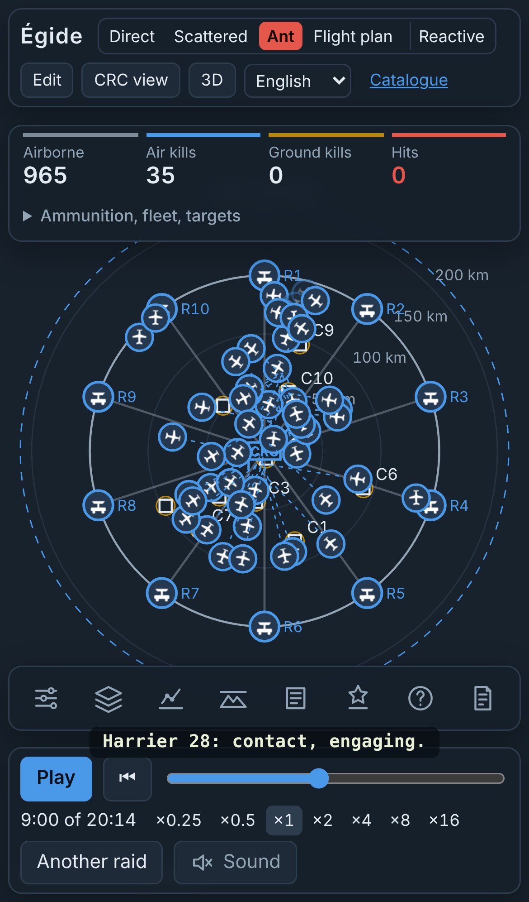
