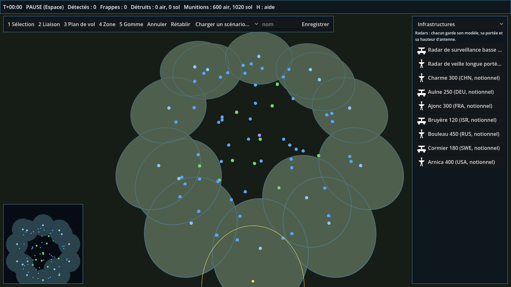
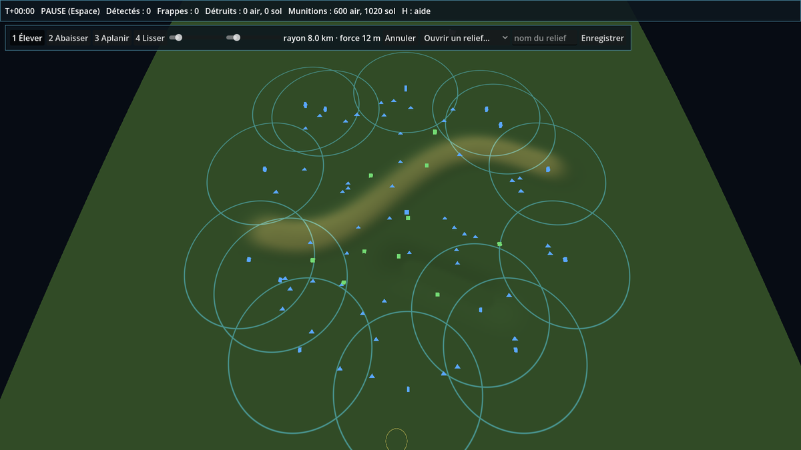

# Clients

*English · [Français](README.fr.md)*

Égide remains the authority: a client reads back a raid already simulated, or drives a game that the server runs; it
simulates nothing. The formats are described in [docs/FORMATS.md](../docs/FORMATS.md) (§ 6 for the replay, § 7 for the
terrain, § 10 for the live game).

## Godot client

`clients/godot/` is a Godot 4 project (MIT licence), in GDScript, with no extension. Tried with Godot 4.4.1 and 4.7.2.

```sh
node src/rejeu.js
node outils/export_terrain.js --terrain terrains/centre_france --pas-km 2
godot --path clients/godot
```

With no argument, it takes the most recent replay and terrain in `resultats/`. They can be named:
`godot --path clients/godot -- --rejeu <file> --terrain <folder> --debut 400 --camera 2 --couverture 3`. The terrain is
optional. Loading the reference scenario takes several seconds.

| Command | Effect |
|---|---|
| Space | play, pause |
| + and − | speed (×1 to ×60) |
| ← and → | go back or forward 10 s |
| 1, 2, 3 | free camera, follow, radar view |
| Tab | next followed drone |
| R | next radar |
| C | coverage shown: detection, fire control, interception, a C2's resultant |
| X | next C2, for its resultant |
| L | switch language (English, French) |
| WASD (physical keys), right button, wheel | move the free camera, look around, change its speed |

Entities are enlarged with distance: at their real size, they would be less than a pixel at the scale of a theatre.
The models are generic shapes built in code.

### Playing live

`./jouer.command` (or `jouer.bat`) starts the game server and the client. By hand:

```sh
node src/direct.js
godot --path clients/godot -- --direct 8767
```

The engine runs in the server, Godot displays and commands (docs/FORMATS.md § 10). The game starts paused.

| Command | Live effect |
|---|---|
| Space | start, pause; an order can be given while paused |
| + and − | speed (×1 to ×60) |
| left click, box | select vehicles; on a radar or a post, inspect it (Shift: add) |
| double click | all vehicles of the same type on screen |
| Ctrl+A, Esc | select all, deselect |
| right click | send the selection to the point aimed at, also on the mini-map |
| Ctrl+1 to 9, 1 to 9 | store a group, recall it (twice: centre the camera) |
| WASD (physical keys), arrows, screen edge | scroll |
| wheel, middle button | zoom, rotate |
| left click on the mini-map | centre the camera there |
| F1 to F4 | strategy, free, follow, radar-view camera |
| C, X, Tab, R | coverage shown, C2, followed drone, followed radar |
| B | lift or restore the fog |
| M, H | mute the sound, show the help |
| N | new game |
| L | switch language (English, French): remembered for the next launches |
| F5 | edit the scenario (the game goes back to the initial instant) |
| F6 | edit the terrain |

Language: English by default; `-- --langue fr` on Godot's command line (or `./jouer.command --langue fr`, which passes it
to the server and the client), otherwise the `EGIDE_LANGUE` variable, otherwise the choice remembered by the L key. The
client tells the server its language when it connects, so the palette, the lists and the refusals come back in it. The
client's texts are the `godot.*` keys of `langues/<code>.json`, copied into `clients/godot/langues/` by
`node outils/langues.js --godot`.

Selecting an object draws its detection, fire-control and interception envelopes, up to eight vehicles at a time. The
fog hides the drones that no radar has seen yet and darkens the ground outside detection range, drawn as discs without
the terrain mask. Sounds and effects are synthesised at launch. A terrain whose origin is not the scenario's is ignored.

### Editing



**Scenario (F5).** Pick a unit in the palette, on the right, then click on the ground to place it: its range follows the
cursor. Right click or Esc to stop. Keys 1 to 5: select (drag to move), link (two clicks), flight plan, area (Enter to
close), eraser. Delete erases the selection. Ctrl+Z, Ctrl+Y undo and redo. The bar saves under `prive/scenarios/` and
loads a scenario. Each gesture goes through the same computations as the browser editor.

**Terrain (F6).** Keys 1 to 4: raise, lower, flatten, smooth; hold the left button to paint. `[` and `]` change the
radius. Ctrl+Z undoes a whole stroke. The bar opens a catalogue terrain or a flat one. Save writes under
`prive/unites/terrains/` and applies it to the scenario: the engine then computes radar masks and lines of sight on
this terrain. Going back to the game without saving discards the retouches.



### Checking the client

Without a screen, the client recomputes the outcome, then `outils/verifier_client.js` compares its positions with a new
simulation. The criterion is at most 1 m, at the same instants.

```sh
godot --headless --path clients/godot --script res://scripts/verifier.gd -- --rejeu "$PWD/resultats/rejeux/<file>" --sortie "$PWD/resultats/dump.json"
node outils/verifier_client.js --client resultats/dump.json
```

The game rules (selection, groups, mini-map, fog) are checked without a server:
`godot --headless --path clients/godot --script res://scripts/jeu/verifier_jeu.gd`.

The live game is checked the same way, with the server running, on the scenario the game saved:

```sh
godot --headless --path clients/godot --script res://scripts/verifier_direct.gd -- --port 8767 --sortie "$PWD/resultats/dump.json"
node outils/verifier_client.js --client resultats/dump.json --scenario resultats/parties/<file>
```

These scripts also take `--langue fr`; their exit code, not their message, says whether the check passed.

## Porting to another engine

The format, the frame and the correspondences do not change. Only the axis conversion depends on the engine.

| Engine | Axes | Position from `(e, n, h)`, h: `u` or `alt` | Rotation at heading `c` |
|---|---|---|---|
| Godot | Y up, right-handed, m | `(e, h, -n)` | `-c` around Y |
| Unity | Y up, left-handed, m | `(e, h, n)` | `+c` around Y |
| Unreal | Z up, left-handed, cm | `(100 n, 100 e, 100 h)` | `+c` around Z |

- **Reading the file**: decompress the gzip, then one JSON line at a time. Store the frames in compact arrays: the
  reference raid has 1.8 million samples.
- **Interpolate** between two frames, position linearly and heading by the shortest path. A frame line is sorted by `id`.
- **Height**: on a terrain, add the ground altitude to the entity's (`docs/FORMATS.md` § 6.3). `hauteurs.raw` gives this
  ground as 16-bit little-endian integers, the height-map format Unity expects.
- **Terrain**: glTF is loaded by glTFast (Unity) or glTFRuntime (Unreal), to be checked for each engine version.
  Importers convert the axes themselves, usually the same way as the table above.
- **Models**: `clients/modeles.json` gives the generic name of each unit. Provide your own; Égide ships none of a real
  system.
- **Attribution**: display the imagery's, given in `terrain.json`.
- **Texts**: `clients/godot/langues/<code>.json` holds the client's texts per language, ready to reuse.
